Это оригинальная статья на русском. Английский перевод — [здесь](/blog/fear-of-calculus-itmo-ai360/). Также опубликовано [в Notion](https://app.notion.com/p/AI360-39fa1d547d5980c7bf16c1d20ea2526f) и [на X](https://x.com/9Rasp/status/2084631748009234511).

Я ел малину на бабушкиной даче, где-то на самом краю обжитого мира, и вдруг завыла Nokia 3310. Беру трубку.

Оттуда — знакомый голос. Я слышал его раньше: на лекциях, ДОДах, ЛКШ, в кошмарах про непокрытые рёбра. Пока я пережёвываю очередную горсть, он говорит ровно, буднично, как диспетчер, отправляющий тебя на верную гибель:

— Ты приезжаешь в Питер. Мы даём жильё в центре. Ты пишешь доклад про нашу новую топовую программу. Фан, еда, дипломы, гонорары — **всё будет покрыто.**

Покрыто. Как вершинное покрытие. Как замыкание по индукции.
Уже тогда надо было бросить трубку в малину и бежать. Но я сказал: «Еду».

И как только я прибыл в этот город-мираж, жизнь превратилась в бесконечный бед-трип, где меня то распирало от восторга и гордости за себя, то кидало в мысли о суициде и в сны про математику.

У нас было два пакетика оценочной пыли, 75 ампул интегрального безумия, пинта разнообразных базисов, солонка, наполовину набитая **полилинейными формами**, россыпь собственных значений всех цветов радуги, флакон с **транзитивным замыканием мозга** — теперь из любой мысли была достижима любая другая. Немного **алгебры Грассмана** в аккуратных клинышках ∧, катушка **кодов Хэмминга** на случай, если реальность начнёт ошибаться на один бит, и ещё целая галактика определений, лемм и сравнений по модулю…
Не то чтобы всё это было обязательно для перехода на **уровень 3**. Но раз уж отправился в Питер в поисках программистской мечты, собирая по дороге все абстракции, до которых дотягиваешься, — остановиться уже невозможно.
Местная тенденция — толкать это настолько далеко, насколько сможешь.

Была запланирована пара поездок на закрытые оккультные практики — так называемые конференции по ИИ. Но мы с адвокатом быстро начали понимать, в чём дело.
Нет там никаких токенов, внимания, энкодеров — чистая вуду-магия.
Люди в бейджах на сцене жгли базисы и вызывали духов через спектральный АНАЛиз, а собственные значения дёргались, как живые, и отказывались диагонализироваться по-хорошему.

Где-то на подъезде к очередной сессии до меня начало доходить, что мы — автомобиль — это в каком-то смысле **конечный автомат**, а случайная перестановка без неподвижных точек — на самом деле идеальная модель тайного Санты. Я решил, что пора порулить адвокату. И тут услышал крик с пассажирского:

> — **Мои ноги. Их защемил предел.**

Опять словил приход от ∫N⊤∃ǤRΛ⋀ MΛÐN∃SS — побочный эффект от перехода на **уровень 3**. Я быстро спохватился, выгреб горсть таблеток и высыпал ему прямо в рот: «стандартный вечерний стек, дыши». Он перестал путать предел последовательности с пределом отображения.

Единственное, что пугало меня по-настоящему, — это **vibescience**. Нет ничего более убогого и жалкого, чем исследователь, продавший душу и разум тёмным силам взамен на скорость: он больше не доказывает, он просто *чувствует*, что теорема верна, и жмёт «принять». Fuck yeah, science. Я знал, что и мы скоро подсядем на это дерьмо. Вопрос был только в том, когда…

Когда я поступал в ИТМО, я не мог найти никаких нормальных обзоров на вуз, кроме пары подкастов, видео (от чела, который перевёлся на бизнес-информатику) и пары минутных роликов со студентами. Пора это исправить!

Расскажу про поступление, AI360, преподов, учебу, поездки на конференции…
Буду максимально честен, но где-то может проступать сарказм и самоирония.
Надеюсь, меня не отчислят 🙏

Актуально на 25-26 год, в следующем году правила могут измениться, а качество улучшится.

## Поступление

Поступал я по БВИ (в ИТМО в наш год брали на AI только БВИ, хотя в других вузах иначе).
У меня был Технокубок и Высшая проба по информатике.

Из альтернативных вариантов были:

- **ПИ ВШЭ** — не хотел на ПИ, общага далеко.
- **ПАД ВШЭ** — только платка (у меня был грант), но я не хотел учиться только с платниками.
- **ПМИ ВШЭ** — В вышку у меня был грант на любое направление [ФКН по конкурсу проектов](https://cs.hse.ru/abitur/konkurs_issl), но я не смог его подтвердить на ПМИ — так плохо написал ЕГЭ.

В пользу ИТМО был AI360, общага в центре, стипа 75к, я не хотел жить с мамой и братом.

### Я в танке, что такое [AI360](https://360-ai.ru/)?

Весь прикол в том, что вы сначала поступаете на КТ, а затем отбираетесь на АИ.
То есть вполне реальна ситуация, когда вы поступаете на АИ, вас отправляют на собес, а вы его не проходите и оказываетесь на обычном КТ или ТопДС.

ТопДС — это те, кто хотел попасть на АИ, но не попал. Они ходят на одни и те же пары, пишут те же контрольные, но не получают плюшек АИ вроде поездок на мероприятия, стипы, сообщества. (кстати, ТопДС есть и в Иннополисе)

После поступления спустя некоторое время после списков прислали форму, где надо было рассказать о себе, своих проектах, достижениях и поездках на смены, а также написать мотивационное письмо.
Я над этой формой конкретно запарился и написал мотивационное письмо о том, почему мне нужно на АИ.
(рекомендую промпт: «Ты — приёмная комиссия, мест мало, желающих много. Прожарь письмо»)

Через некоторое время вам приходит письмо счастья. Или расписание собеседований.

По опросу одногруппников могу сказать, что на проход без собеса влияет то, какие олимпиады у вас есть, а не насколько вы крут в форме.

Без собеса поступали всеросы, СПбГУ по инфе, ИОИП.

С собесом: ВП по инфе, физтех побед по математике, Ломоносов по математике, турлом.

На собесе не было задачек. Поспрашивали про то, почему АИ, чем хочу заниматься после выпуска (я ответил, что хочу получить фундаментальное образование, а потом сделать технологический стартап… Что-то я пожалел после собеса, что это сморозил, но всё обошлось).
Спрашивал, по сути, один чел из Яндекса. Остальные либо слушали, либо сидели с выключенными камерами.

Ещё через некоторое время мне приходит письмо счастья, меня добавляют в группу, и оказывается, что через несколько дней — организационная встреча в ИТМО.

На встрече нам рассказали второкурсники про учебу, мы познакомились друг с другом, и оказалось, что через неделю я еду обратно в Москву на Introduction weekend — мероприятие, на котором собирают всех аишников со всех вузов и знакомят с бигтехами.

И если остальные вузы эту неделю упорно ботали, перваки ИТМО ходили на Introduction days: набор мероприятий от клубов и внутренних организаций ИТМО.
Честно говоря, в значительной мере было уныло и скучно, главным образом потому что на “станциях” люди зачитывали одну и ту же речь по 10 раз в день…
Из интересных станций: навигация по Санкт-Петербургу, где рассказывали про историю корпусов, и музей оптики, где проводили экскурсии.

## Introduction weekend

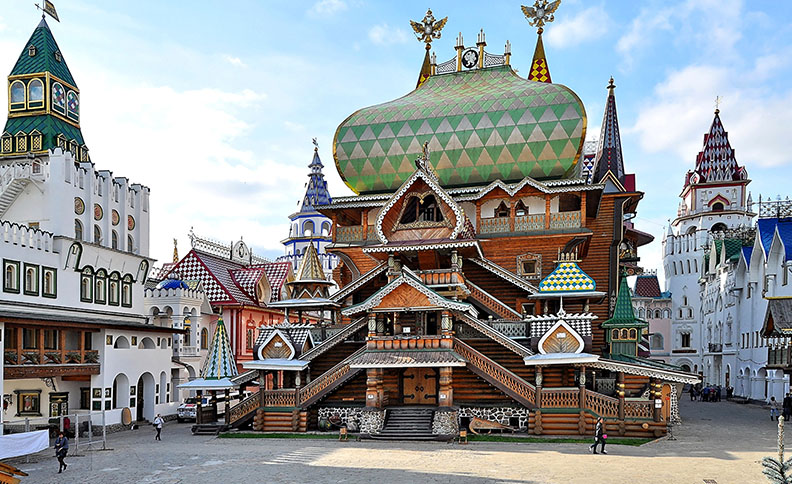

Типичная Измайловская высотка

Приехали в Москву на Авроре, заселились в Измайлово и на следующий день отправились в СберУниверситет.

Там нам раздали мерч, накормили, рассказали про курсы [ШАДа](https://shad.yandex.ru/) и какие общие мероприятия планируются в течение пары лет.

Основная суть: в AI360 участвуют разные вузы, и у каждого своя программа. Объединяют их проектные школы — мероприятия, где мы делимся на команды, получаем ментора из бигтеха и работаем над каким-то проектом, — а также события вроде introduction weekend и сбора первого и второго курсов.

После была пара лекций. Кто-то говорил, что слушает одну из них третий раз. Хорошо поспали.
Дальше нас хорошо покормили, разделили на команды и отправили общаться с экспертами из Сбера и AIRI про их работу. Замотивировались на работу в Сбере.
Потом развлекательный квест и афтепати с гитарником.

На второй день релоцировались в Красную розу.
Почитали развлекательные лекции про погоду, Алису и ещё что-то, наверное, было, но я не помню…

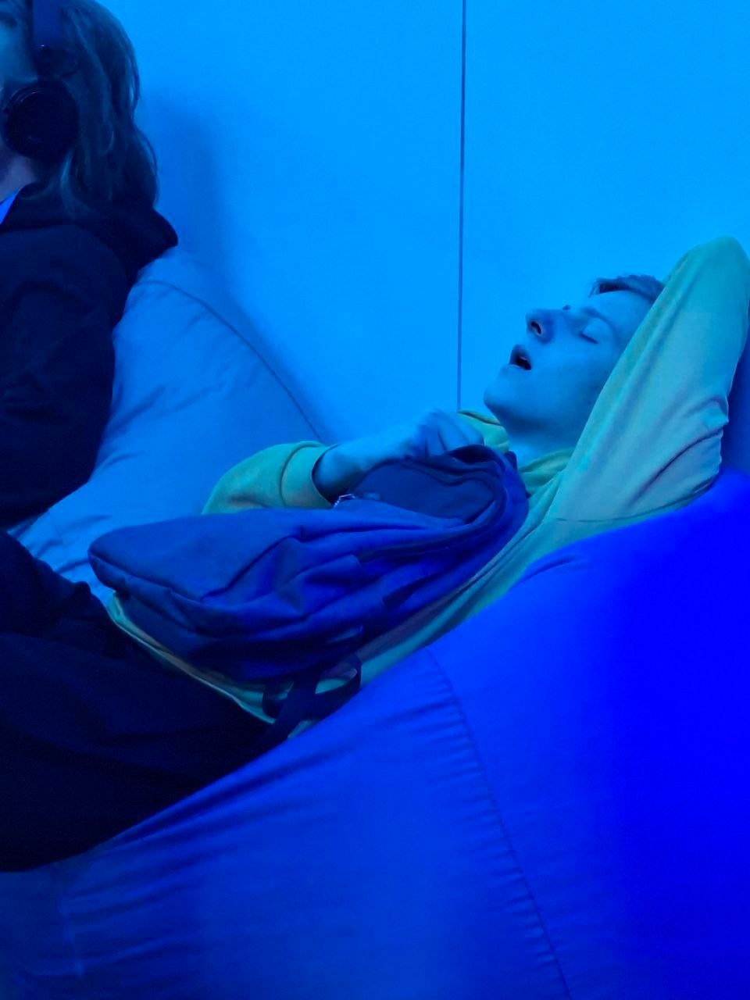

Шикарная лекция!

Я думал, что в Сбере был шикарный обед, нет — Яндекс повёл нас в ресторан, и мы не смогли съесть всё…
Провели экскурсию по офису.

Устроили тоже какие-то игры на баллы, раздавали мороженое.
Мы с ИТМО скинулись баллами и купили Алису — теперь она стоит у нас в общаге и играет музыку, управляет светом, чайником, шторами, дверью, нами.

На следующий день мы поехали обратно в Питер учиться.

## Учёба

Все лекции записываются (зависит от вас, конечно). [Можете посмотреть сами здесь](https://www.youtube.com/@ctlectures/playlists).
Посещения никак не отслеживаются (кроме английского, КиКа).

### Отчисление

Есть 3 попытки сдачи экзамена до отчисления: экзамен, доп сессия/допса/пересдача 1, комиссия/пересдача 2/комса → отчисление.

Хотя на самом деле с АИ и ТопДС пока ещё никого не отчисляли, только переводили в младшие группы КТ 33, 35. (чем больше цифра, тем сложнее, 32-39)

### Система оценивания

Система балльная; то, как распределяются баллы, зависит от предмета. Где-то экз обязателен, где-то нет.

### Про предметы

Коллоквиумы и экзамены — в формате билетов: тянешь, пишешь что знаешь, идешь отвечать.

#### Математический анализ

Неделя начинается с матана. Его ведет Константин Петрович Кохась, призер межнара и друг Перельмана.

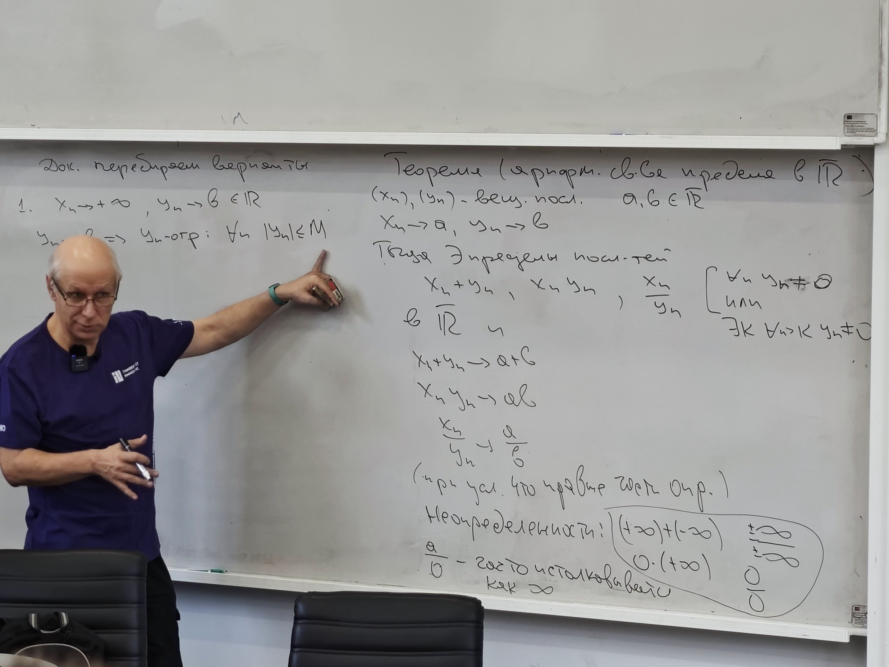

2 лекции, практика (практикант зависит от группы). На практике половина решает, другая едва понимает, что происходит.
Программа по учебнику Виноградова. Сам он ведет у КТ 39 группы, но его лекции похожи на чтение учебника из памяти, а Кохась иногда шутит, прикалывается, дарит на новый год леммы об игре в гекс… 😇

Пожалуй, это самый сложный курс (44% на допсе во втором семе 🤩): больше всего людей отлетает на пересдачи, и всей группой мы идём на переписки КР.
Благо задания там типовые и на второй переписке решаются, если готовиться, но со штрафом.

[Таблица с билетами 1 и 2 семестра](https://docs.google.com/spreadsheets/d/108RhDNyRjrv1Wh7ofY6A3lLQ1yWBfk-38EjEQf2I-uw/edit?usp=sharing)

#### Линейная алгебра

Курс ведет Александр Трифанов. У АИ ведет и практики.

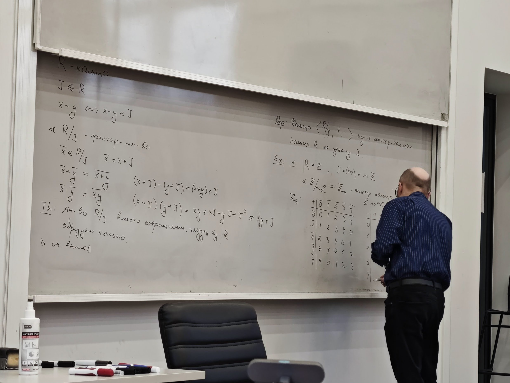

Кто-то считает лекции слишком абстрактными, но зато лектор сам делает конспекты по каждой лекции.

В течение семестра есть пара коллоквиумов, к которым допускают после теста.
На нем стараются закрывать, на КР нет понижающего коэффициента, есть возможность пересдать в период основной сессии.

[Билеты 1 и 2 семестра](https://drive.google.com/drive/folders/1HlFWuuOsXTuAQ72pPF9A_AU84foRhZV7?usp=drive_link).

#### Дискретная математика

Лекции читает декан КТ — Андрей Станкевич. А у одной из групп ещё и практики.

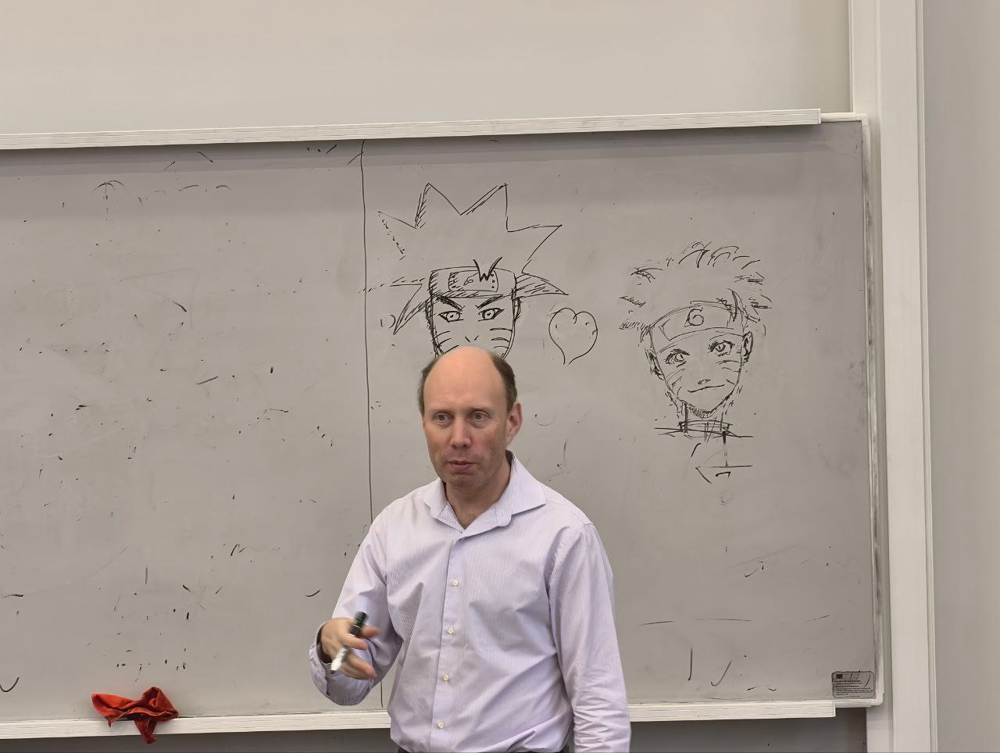

На них мы [решаем задачи и отвечаем у доски](https://neerc.ifmo.ru/wiki/index.php?title=%D0%A1%D0%BF%D0%B8%D1%81%D0%BE%D0%BA_%D0%B7%D0%B0%D0%B4%D0%B0%D0%BD%D0%B8%D0%B9_%D0%BF%D0%BE_%D0%94%D0%9C_2025_%D0%BE%D1%81%D0%B5%D0%BD%D1%8C), ещё есть контесты на PCMS 🤩 и небольшие тестики под прокторингом.

<video
	controls
	muted
	playsinline
	preload="metadata"
	poster="/blog/fear-of-calculus/discrete-quiz.jpg"
	src="/blog/fear-of-calculus/discrete-quiz.mp4"
	aria-label="Типичный вычтест. Дедлайн в 8 утра — как раз перед сном."
></video>

Типичный вычтест (дедлайн в 8 утра, как раз перед сном)

Все темы здесь: <https://neerc.ifmo.ru/wiki/index.php?title=%D0%94%D0%B8%D1%81%D0%BA%D1%80%D0%B5%D1%82%D0%BD%D0%B0%D1%8F_%D0%BC%D0%B0%D1%82%D0%B5%D0%BC%D0%B0%D1%82%D0%B8%D0%BA%D0%B0>

#### АИСД

Курс вел приглашенный лектор из СПбГУ: [Даниил Сагунов](https://danilka.pro/).

Прикол в том, что на программе хотели, чтобы было как можно больше преподов с опытом в исследованиях, а не только людей из индустрии.
Поэтому на практиках он нас просил не только показать идею, но и доказать, что она работает.

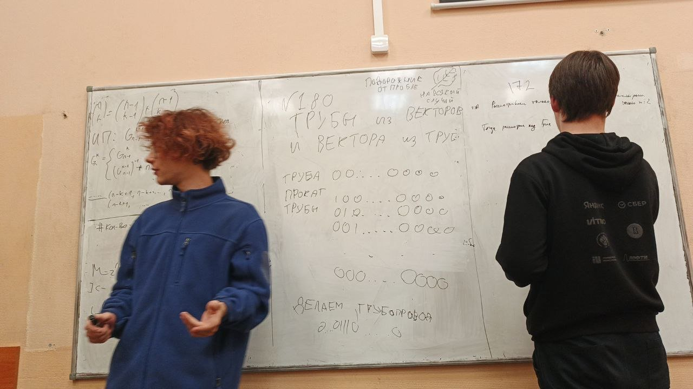

ИМХО, курс охватывает много всего, но нетребовательный. Бывало, на тему приходилось всего 1–2 лекции, а на практику приходило 3 человека решать по 1 задаче (из ~20 ⚰️).
Во втором семестре просто не успели провести КР, и мы закрывались чисто лабой на CF и практиками.

#### JAVA — это java. [на лучшем языке писать имеешь право…](https://www.youtube.com/watch?v=4HyxdM-8eU0)

В первом семе вел джаву Николай Ведерников.

Лекция, после — лаба.
Пишешь и приходишь защищать: тебя чуть тыкают в код, говорят: «Ладно, садись».
Или неладно, и ты идешь что-то чинить.

Курс несложный, особенно нынче. Главное не забивать и ловить вайб.

#### C++ “лаба простая, работы минут на 20” — skkv©

Во втором семестре джава сменилась плюсами и ведет её легенда КТ — Павел Скаков.
Также он ведет АрхЭВМ у КТ и АКОС на АИ на втором курсе.
Лекции не записываются из принципа. Вайб ловить — опасно.
(На ТопДС плюсы у Ведерникова)

Почему легенда? Потому что это один из самых жестоких преподов (60% на допсе у КТ, у нас 44%).
В плане — он заставляет знать предмет хорошо и не дает проскочить.

Все начиналось гладко: сначала тебе рассказывают про компилятор, линковщик. Засыпаешь… А просыпаешься от вопроса, чему равна мантисса и экспонента в числе 5.812?
А ещё через пару лекций мы перешли к плюсам.

Сидишь на защите лабы и мычишь на вопрос, что такое std::iota.
Я что знаю? Вы попросили C++ 23 — работает же!

Всего 3 лабы: Эмуляция Floating point, TIFF converter и движок инференса простой нейросети MNIST-Fashion (ML часть была написана за нас (тоже нейросетью)).
Скаков — фанат стандартов.

Без экзамена закрыться на 5 невозможно, на экзамене ты пишешь код на листочке: если он не компилируется в голове у принимающего, то получаешь 0, если он «плохой» (по его мнению) — отрицательные баллы.

#### Английский

Я попал в группу C1 после небольшого распреда.

Ведет его у нас Муфолалу Чипо Мубалу. На парах мы 3 часа разговариваем и неторопливо решаем почти рандомные задания из учебника. Кто-то решает ДЗ, кто-то сидит в ноутах.

В первом семе я ходил на половину пар.
На допсе была унизительная очередь, где ты зачитываешь задание и снова ждешь час.
В финале мне не хватило пары баллов, и я отправился на комсу.

Там меня ждал онлайн тест, без прокторинга, но с разговорной частью. Закрыли.
Во втором семе я не появлялся ни на одной паре.

#### Коммуникации и командообразование

Все на первых курсах КТ знают: выборность — это ложь. В нашем случае выбирать можно только препода КиКа…

Прекрасный курс, потому как учит работать в команде и общаться с людьми.
Основная проблема, что он начинался в 8 утра.
Главный навык коммуникации проявился в том, что на одной из пар я просто сам проставил себе баллы на перерыве.

Попался классный и энергичный препод (Валерия Лимонова, рекомендую), но я как-то прошел мимо курса.

#### Про факультативы

Первые 2 года вы вряд ли что-либо успеете.
Я записался на “Навигация по Санкт-Петербургу” — по выходным водят экскурсии по центру, Елагину острову и по районам…
Нужно набрать треть посещений и простое ДЗ. (это здесь вообще от курса зависит).
Очень рекомендую, при том, что он проходит по выходным и ничего особо не требует.

Во втором семе я записался на Data Art, но не хватило времени туда ходить.

Если ты записался, но не сдал дважды — запись на факультативы для тебя закрывается, но недавно узнал лайфхак от магистранта: можно найти препода в системе ИТМО и попроситься вольным слушателем. Отходить занятия и записаться на курс, когда уже будешь точно знать, что закроешь его.

#### Физра

В интернетах много рассказывали про спорт в ИТМО.
Ты можешь ходить на разные занятия как тебе удобно, но всё меняется, если ты записываешься на секцию: тогда можно закрываться только ей.
Можно даже спорт прогой и шахматами.

Есть основные и бонусные баллы. Основные за спорт, бонусные за ICPC и турниры по Brawl Stars.
Кстати, за простое участие в 1/8 ICPC давали баллы по ДМ и АИСД + 50 баллов по физре (а это половина). Так что даже если вы математик, то поучаствовать стоит.

Я записался на скалолазание. Оказалось, одна из самых требовательных секций.
За всё время здесь было 3 КТшника…

Когда я пришел туда — все учились подтягиваться.
Я пришел через месяц и был наравне с другими.
Потом случилась комса, я сломал палец и думал бросить, но продолжил ходить (после напряженного разговора с тренером).

В финале летом я поехал на сборы на настоящие скалы на 10 дней, и это была прям награда за то, что я не бросил. Скалодром — это другое.

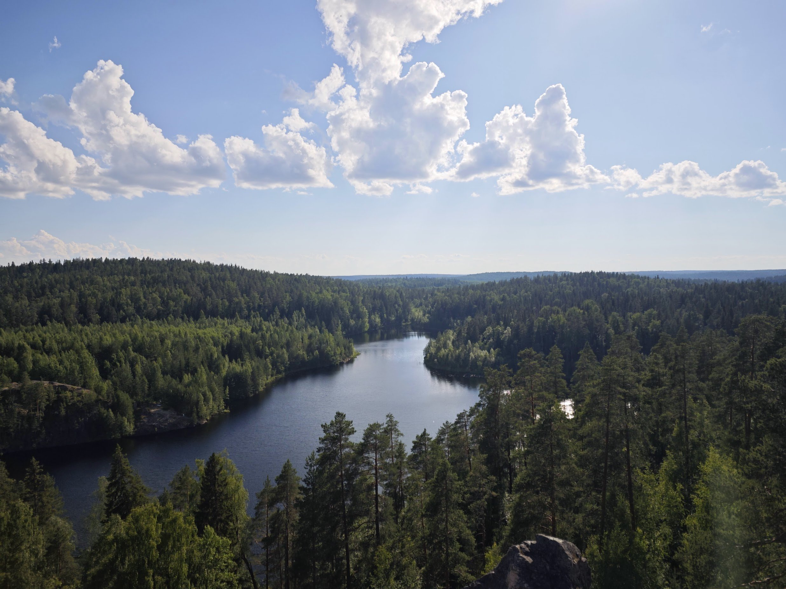

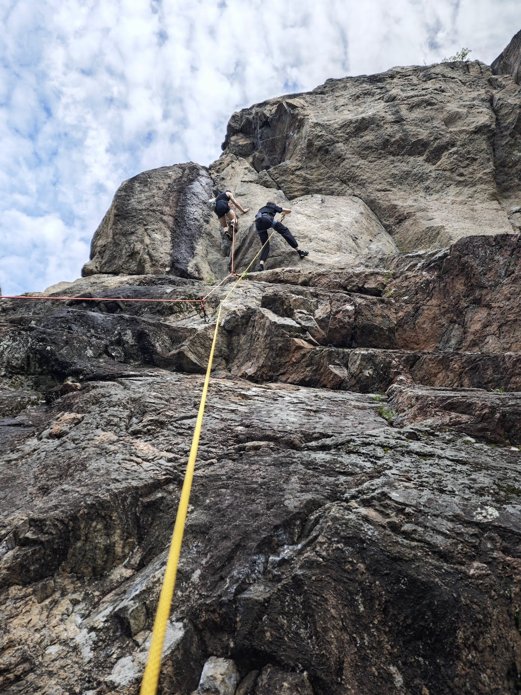

Нет ничего лучше, чем совершать рывки, стоя на камешках размером с фалангу большого пальца на высоте 20 метров, не видя страхующего 🤩.
Рекомендую.

Ещё я хотел ходить на танцы (вы можете договориться ходить на 2 секции с тренером, однако баллы получать не будете), но у меня произошел коллапс временного континуума и дальше первого занятия не пошло.
Но мне понравилось танцевать с женщинами. Тоже рекомендую.

#### Чуть не забыл курс ШАДа: πton

Это общий курс для аишников со всех вузов, но лектор там не очень был (заикался буквально), поэтому спустя пару месяцев на лекциях (они онлайн) была пара человек без камер.

Откровенно говоря, многие его катали (кроме нескольких принципиальных и умных людей) и толку от него было мало.
Кстати, ещё грант на 3к в Яндекс Облаке дали: на обход БС летом, похоже.

### Таймлайн

В течение семестра была ещё пара мероприятий:

Хакатон Яндекса по табличному ML.

Посвят — сначала были кринжовые игры совместно с программной инженерией, а потом пошли бухать на дискотеку под попсу.

После слитой КР по линалу и матану, до меня начало доходить, что в вузе надо учиться внезапно.

Хакатон направления ТопДС — там разыгрывали стипендии.
Слил на него выходные — занял 4-е место (на следующий день КР по матану)…
Ни одна команда с AI360 не взяла топ-3.

#### AI Journey

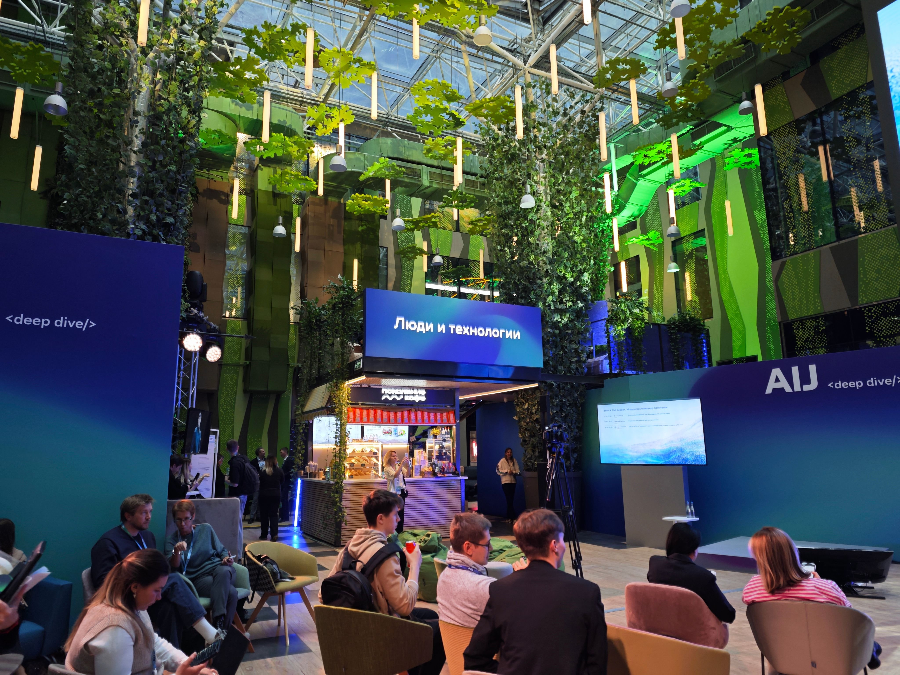

Ещё всех, кто захотел, отвезли на AI Journey — конфа от Сбера в Москве.
Кто-то там спал, но были и интересные лекции. Например, про старение от Дмитрия Крюкова.

#### Сессия 💀: расстрел иллюзии компетентности под страхом отчисления

Наступила она внезапно в январе: матан 16, через неделю линал, ДМ, пересдача линала, допса по матану, комса по матану…
А вот последнее было страшно, очень страшно (ибо дальше отчисление).

Рассказываю, как я до такого докатился: дело в том, что я не учился в лицее, не сдавал экзамены в таком виде. Я не знал, как в целом готовиться к такому.
К комсе пришлось понять: осознать билет и воспроизводить его в голове, регулярно повторяя. Наверное, это покажется очевидным, но для меня тогда — нет.
Когда я пришел на экзамен, я не знал вообще ничего почти из теорем, мне кажется.

На допсе я что-то намычал, но, когда меня спросили черное определение (обязательное, непрерывность отображения), я не смог ответить.
Я не понимал различия предела последовательности и отображения.
Проблем добавляло то, что после допсы начался второй сем и приходилось балансировать между сдачей дедлайнов и подготовкой к комсе.

Также в период допсессии я переписывал КР по матану, их в целом много кто переписывал. Прикол в том, что если на первом написании ты получаешь 20 баллов за задачу, то на последнем — 10, и для того, чтобы закрыться, нужно решить ВСЕ задачи (4 в первой КР и 4 во второй).

Это страшно, но по опыту первого сема на допсе оценивали чуть более лояльно. Мне, например, поставили баллы за лажу, но снизили их там, где я всё правильно расписал.

Комиссия — это как допса, но твою судьбу решают уже несколько преподов (ИМХО, чуть более лояльно). Если ты не закрыл практику, будут задавать задачки.

На комсе я переизобретал матан 5 часов. Оба билета я не знал, но по названию догадался. Меня потыкали в доказательства, и я с горем пополам их поправил.
Какой же это был груз с плеч, но, с другой стороны, честно: если студент не понимает суть пределов — какой матанализ?)

И только я разобрался с прошлым, а тут второй сем в полном разгаре!

Я клянусь себе, что теперь точно буду учиться и ходить на все пары: я держался 2 недели.
Потом решил: надо бы подаваться на стажировки. В Америку.

#### optiHealth — Everything is a Vector Custom Temporal Encoder

На «Дне Яндекса» в ИТМО меня познакомили с Юрием Рыковым — учёным из ИТМО, который занимается анализом данных с носимых устройств. Летом я делал платформу для этого, и мне тоже интересна эта тема.

Он подкинул идею: реимплементировать SensorLM — LLM, которая понимает данные с сенсоров, распознаёт активности и гипертонию и умеет описывать их словами.

Я решил: сейчас быстренько, за пару недель, намучу эту модельку — и обучу за часик на RTX 5070 младшего брата то, что Google гонял 100 часов на кластерах TPUv6. Я на открытых датасетах (у Google было 60 тыс. минут данных…) И напишу в Whoop, Oura, Empatica и Fitbit о том, какой я классный, возьмите меня…

Спустя три недели попыток у меня есть 20 000 строк вайбкода. Он не работает.
Точнее — работает, но генерирует бред.

Времени доводить до ума нет: иначе на стажировку я точно не попаду. Поэтому я забиваю на код и сажусь за outreach-список. Пишу ИИ-инженеру в Whoop что-то вроде:

> — Привет. Реимплементирую SensorLM. Вы что-нибудь делаете в эту сторону?

Он отвечает:

> — Ты реимплементировал ЭТО? Если да — интересно обменяться опытом и датасетами.

Рассказываю: что работает, что не работает, как пытаюсь чинить. Через пять минут:

> — Давай созвонимся.

Созвонились. Повезло, но не так, как я думал: в Whoop он не занимается ML, а больше крутит API OpenAI. Зато скинул контакт коллеги, который делает foundational-модель, и обмолвился, что через год они планируют fusion — ровно то, что пилю я.

С Виллом — тем самым коллегой — я так и не созвонился: сначала закрывал долги, потом проектная школа, сессия, отдых…

Кстати если у вас Fitbit или Android, то платформу анализа данных [можно потестить здесь](http://optihealth.devpins.org/).

#### Проектная школа

В конце первого курса, аккурат когда над всеми уже нависала сессия, нас погрузили и отправили в Москву на две недели Проектной школы.

Жили в «Веге Измайлово», а каждое утро в семь вставали на завтрак и ехали трансфером в очередной небоскрёб — то в яндексовский офис в «Око», то в сберовский на Кутузовском.

Первые дни — лекции от индустрии, дальше работа в командах по офисам, мидревью в середине, один выходной с экскурсией в Центр робототехники Яндекса, и защиты под конец, 25 мая. А сразу за школой, 26–27-го, там же в «Веге» — сбор первого и второго курсов AI360.

Звучит бодро. На деле добрую половину этих двух недель люди втихаря готовились к сессии, а презентацию проекта накидывали за вечер до защиты.

Начну с команд. Я приехал с романтической идеей: собрать команду из ребят с разных вузов, перезнакомиться, обменяться мозгами. В реальности мне досталась смесь из тех, кто искал халявы, и тех, кто ничего не знал и боялся узнавать. А по соседству стояла команда из ИТМО, где все шарили, где и задача поинтереснее, и ментор покруче, — и туда меня, кстати, звали. Мораль, которую я вынес: лучше собираться с теми, кого хорошо знаешь, чем с абстрактно «разными».

Дальше было распределение задач, устроенное примерно как лотерея, но с лазейкой: можно было голосовать за чужую команду и перетягивать задачи. Сокомандники предложили сжульничать — ну я и... (Клод одним промптом разобрался в API форм и заслал голоса). Тонкость в том, что новый голос перезаписывал старый, а я думал, там усредняется по посылкам, — знал бы, не лез. Когда я гордо доложил команде о содеянном, они как-то напряглись: видимо, предложение было саркастическим, а я не выкупил. В итоге ребята написали организаторам, и всё разрулили.

Задача, которую мы вытянули, звучала благородно — «вот вам датасет, проанализируйте и улучшите метрику». А на месте превратилась в «мы навайбкодили сервис, сами придумайте метрику, сгенерите синтетический датасет и оптимизируйте его». По крайней мере, так это понял я.

И это, в общем, показательно: в начале школы, когда спросили, будут ли оценивать за UX, продукт и работоспособность, нам честно сказали «нет», я ещё поддакнул, что в ресёрче и отрицательный результат — результат, и услышал «само собой!».

После чего выдали список задач, где большая часть — инженерные и часто вообще мимо ML (ИИ-агент, при всём уважении, это не ML), а на мидревью в середине школы нас вдруг принялись гонять по UX и UI.

Обиднее всего, что наш ментор так и не предложил ничего вокруг ARGUS — а у него ровно на эту тему магистерская: и человек шарит, и тема живая, почти bleeding edge. Кажется, менторов и их проекты в следующий раз стоило бы отбирать чуть придирчивее.

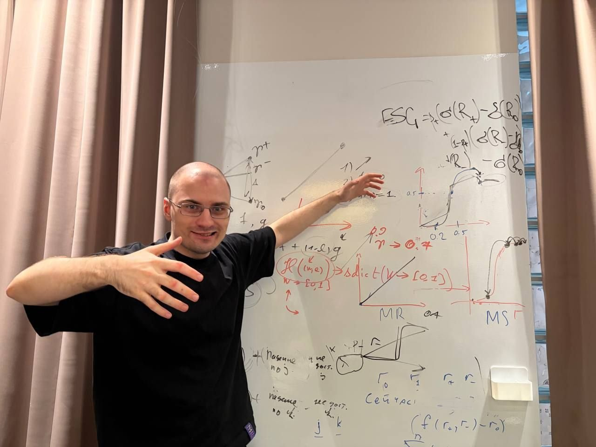

Наш ментор за своим вайбкодом

Про менторов вообще ходили легенды: кто-то почти целиком ушёл на удалёнку, кто-то писал диплом, пока команда пахала, кто-то и вовсе уехал на роды. Я не про то, что ментор обязан гореть круглосуточно — просто не всем в принципе было интересно возиться с первокурсниками.

Оно и понятно: исследователей не напасёшься нянчиться с нами, да и менторство — отдельный навык. Но тогда всё чаще ловишь себя на мысли: может, лучше один злой и замотивированный ментор на несколько команд, который раздаст пересекающиеся куски, а в финале они соберутся во что-то целое?

Лекции перед командной работой были разные. Часть — интересные, часть — не очень (у людей просто мало опыта выступлений), кто-то жаловался, что слишком сложно — курса ML-то ни у кого ещё не было. Но главная беда даже не в сложности, а в том, что почти всё было развлекательным и без сквозной структуры: послушал про беспилотники Яндекса — здорово, а дальше-то что с этим делать? Практическую часть, по ощущениям, трогали процентов пятнадцать. А была и лекция про ML в футболе, на которой лектор мычал, а зал занимался своими делами, — вот это уже за гранью.

Но настоящая, личная драма школы — это история про мой собственный проект (optihealth). Ещё до старта я пытался договориться делать своё и наткнулся на вежливое игнорирование: «так нельзя».

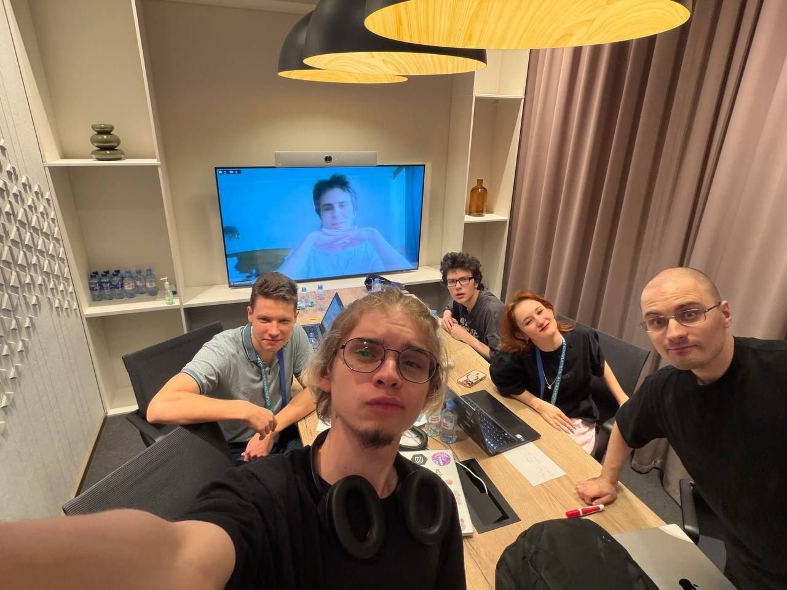

Команда

В команду меня, подозреваю, взяли по расчёту: сейчас ему официально откажут, он выдохнет, будет тихо пилить свой кринж, а мы пойдём бухать. На школе, получив ту самую «странную» задачу, я всё-таки спросил у Алексея Толстикова (руководителя ШАДа) про смену на своё. Он ответил примерно так: «Было бы здорово, если бы ты придумал что-то про анализ данных, а не про обучение, но если команда и ментор не против — можно».

И вот в момент, когда дверь открыли, у меня на месте не родилось хорошей идеи по анализу — при том, что она лежала на поверхности, я над ней даже раньше работал.

Я предложил допиливать Custom Encoder (который я для стажировки делал), но команда пасанула: «слишком сложно, непонятно, оно вообще может не заработать».

Ирония в чистом виде: вытянуть «странную» задачу, получить разрешение её сменить — и вернуться к ней же из страха перед ML.

Кажется, я понял, откуда этот страх растёт: за школу ставят оценку, у половины здесь синдром отличника, а на горизонте маячит поездка в Корею — и рисковать «каким-то там глубоким обучением» и сырым проектом, который может вообще не заработать, никто не готов.

По-моему, оценка тут вообще лишняя. Кстати, а она была? Я про систему оценивания так ничего и не узнал — просто получил свои 4.

После школы был сбор первого и второго курсов: я перезнакомился с ребятами из всех вузов, пообщался с экспертами на Random Coffee, а на Research Park — мероприятии, где ты представляешь своё исследование, — рассказал о проекте перед всеми и увидел искренний интерес в ответ. Возможно, они присоединятся к нему.
Ещё к нам приезжали Тигран Худавердян, CEO Яндекса, Дмитрий Масюк, руководитель поиска Яндекса и Иван Оселедец, директор AIRI.
Плюс по вечерам был нормальный человеческий отдых: боулинг, бильярд, настолки и просмотр фильмов.

## Остальное

### Вязьма (общага)

Мать меня пугала тем, что здесь будет один душ на 10 этажей, будет очередь на кухне, а я неделю не буду ходить в туалет, — оказалось, неправда.

Из-за того, что я поздно занял очередь на сайте, мне досталась коридорка, но зато я поселился втроем с одногруппниками. Всех аишников поселили на Вязьму.

Жизнь на Вязьме — это отдельный микрокосм. Музыкальная комната, столовка, студия звукозаписи, качалка, бильярд, барахолка. Это маленький город.

До Кронверкского идти 30 минут, но можно и за 15 добежать. Рядом Елагин остров, Приморский парк. Только не заселяйтесь в коридорку окнами на улицу — трамваи не дадут вам спать.

### Корпус

Все занятия проходят на Кронверкском. Есть 4 коворкинга, которые, конечно, поприятней боталок физтеха ;)

3 большие аудитории, много классов поменьше.

Хорошая столовка, магазины, кофейни рядом.

### Про Питер

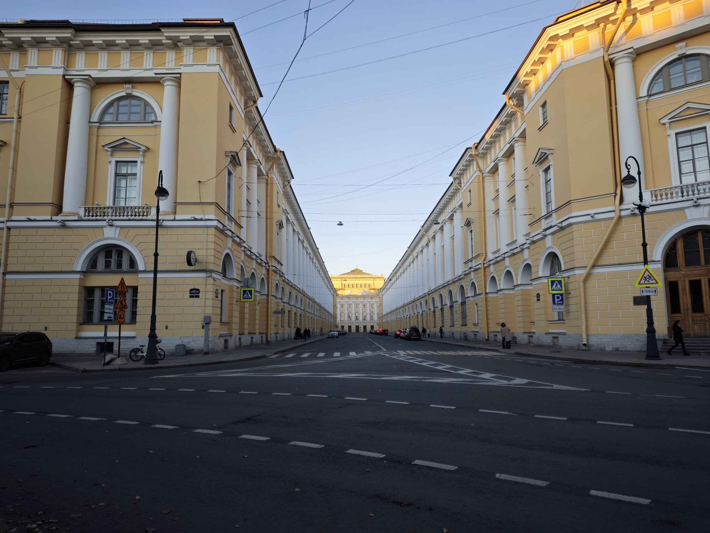

Елагин остров

Переехав из Москвы, я не ощутил, что чего-то мне не хватает. Кафе, магазины, б/у-рынок, маркетплейсы, музеи, парки…

Хотя, по правде говоря, всё это не так важно, ибо, скорее всего, вы будете весь год задротить, едва успевая куда-либо сходить.

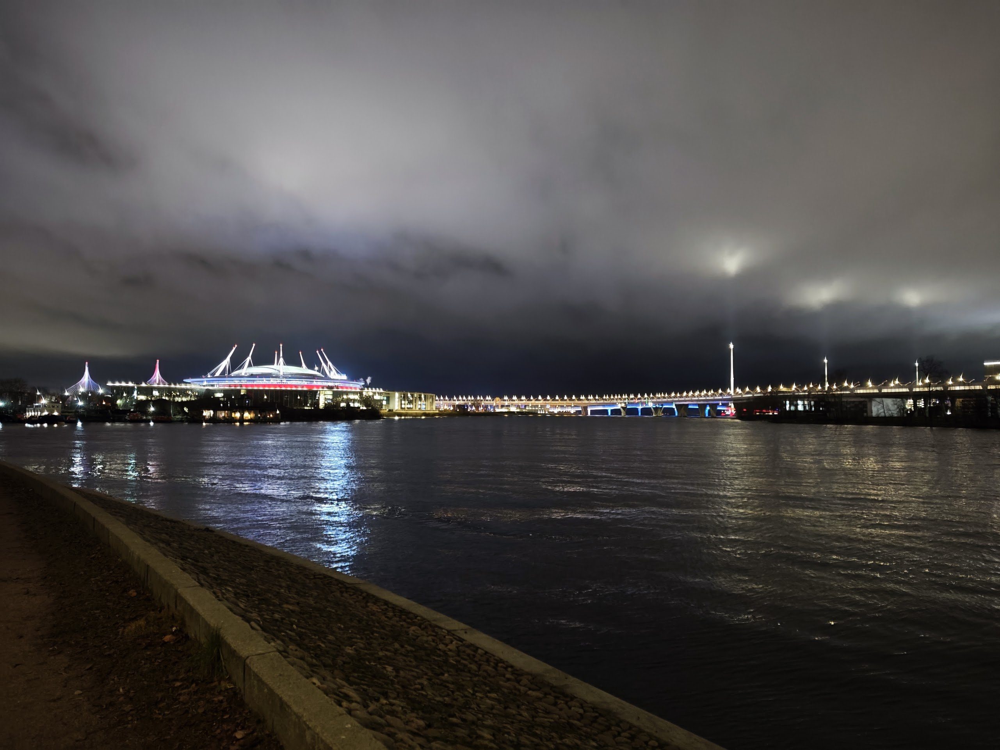

Вид на Приморский парк

### Сложно ли учиться?

Это зависит от вас. Если вы выпускник топовой школы и вам легко дается математика, то закрываться несложно. Хотите доп стипендию поверх 40к и ездить на конференции? Придется поднапрячься.

Если нет матбазы, то может быть тяжело осознать большой поток абстракций.

Но в то же время на топдс учатся платники и как-то закрываются на хорошие оценки, переводясь на бюджет. Так что всё реально и зависит от желания и академической честности.

### Правда ли повезут на конференции?

Да, но для этого нужно было закрыть семестр с одной четверкой. В ИТМО уже 2 человека ездили на ICLR в Бразилию, а остальные отличники поедут в августе на KDD в Корею.

### Про AI360 в других вузах

Как я и сказал в начале, каждый вуз сам решает, как отбирать студентов и чему их учить.

Так, в Вышке, например, брали платников, но если у тебя нет всероса или открытки, то шансы нулевые (там балльная система отбора). Ещё в Вышке с первого курса ведется обязательная исследовательская деятельность (и из-за нее отчисляли со второго курса уже 🪦).

На физтехе брали только бюджет, но можно было поступить по ЕГЭ. Тех, кто в форме отбора не ставил галочку «хочу в науку», не брали даже со всеросом.

А в СПбГУ брали без собеса, сразу по БВИ и по ЕГЭ. Правда, момент в том, что если поступаешь по ЕГЭ, то общагу выдают в Петергофе 😬

## Заключение

В общем, если бы я откатился год назад и выбирал, то я бы не выбирал и поступил бы снова в ИТМО на AI360.

Хоть есть и какие-то шероховатости в организации мероприятий (но где их нет), я получил доступ к крутому сообществу, хорошей стипендии и фундаментальному образованию.

В общем, жду вас в ИТМО и на AI360, а у меня уже закончил работу над моей мегаплатформой по анализу данных раб агент.

Пишите в чаты абитуриентов и мне в ЛС [@AntonlX](http://t.me/AntonlX)

Можете еще подписаться на тг канал с планами на день для мотивации: <https://t.me/devpins1>
