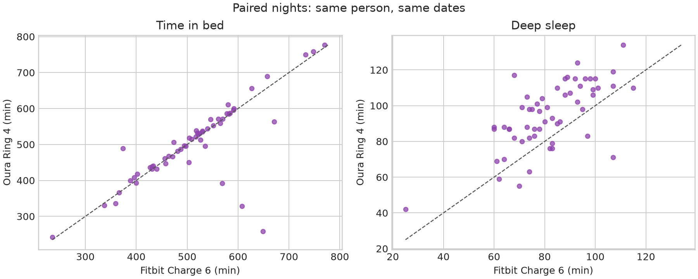
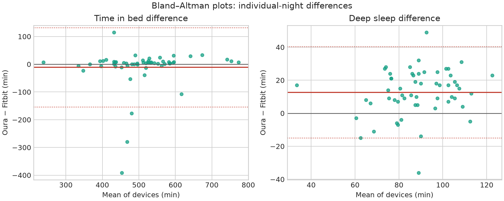
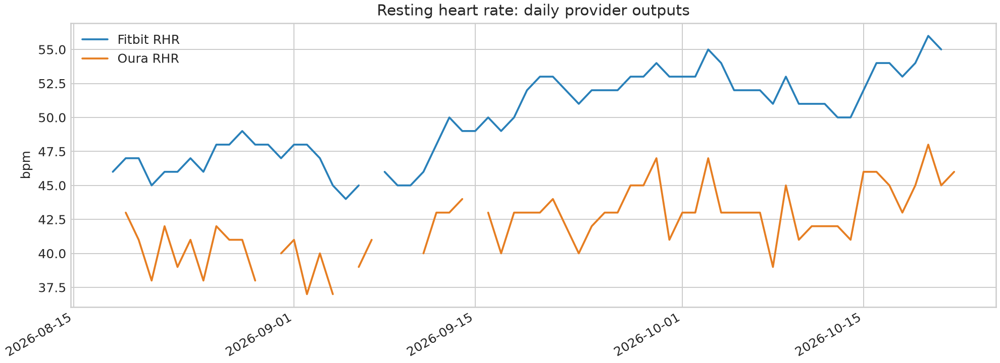

## Краткая версия

Я продал свой Fitbit Charge 6, но перед этим у меня было достаточно данных, чтобы сравнить его с Oura Ring 4 — не по впечатлениям, а по датам в OptiHealth.

**Основной результат:** устройства достаточно хорошо согласуются в отношении общей формы ночи: когда ночь длиннее или короче, оба обычно это видят. Но это не взаимозаменяемые показатели сна. В этом образце Оура зафиксировала немного меньше времени в постели и общего сна, больше времени бодрствования и еще около 13 минут глубокого сна. Fitbit предоставил более плотные данные о частоте пульса и активности; Оура превратила ночь в более богатый контекст восстановления.

Это не значит, что Oura «права», а Fitbit «неправа». Это означает, что два закрытых классификатора по-разному проводят границы между сном, бодрствованием, движением и восстановлением.

## Откуда взялось сравнение

Для сравнения используются мои данные OptiHealth:

– **Fitbit:** источник Google Health 35 с метаданными `connectedAs=google_health_fitbit`;
- **Oura:** Источник Oura OAuth 72, с метаданными `connectedAs=oura_ring`;
- окно первичного сравнения: **18 августа – 22 октября 2026 г.**;
- сон был сопряжен с локальным `sleep_sessions.day`, используя только `is_nap=false`;
- это составило **56 парных ночей основного сна**, с 19 августа по 21 октября;
- ежедневные показатели имели **66 общих дат**: с 18 августа по 22 октября.

Название «Oura Ring 4» относится к кольцу, используемому в этой установке. База данных идентифицирует соединение Oura как `oura_ring`, но не сохраняет отдельное поле модели устройства. Таким образом, это сравнение одной личной установки, а не лабораторное испытание каждого Charge 6 и каждого Ring 4.

Все цифры ниже носят описательный характер. `Oura − Fitbit` — это разница со знаком. Корреляция Спирмена показывает, движутся ли значения вместе; оно не показывает, какое устройство ближе к истине. Для среднего парного разрыва я использовал бутстрап скользящего блока с семидневными блоками. Интервалы для отдельных ночей представляют собой пределы согласия, а не доверительные интервалы для среднего значения.

## Краткая история двух продуктов

Fitbit Charge 6 был выпущен в сентябре 2023 года как наручный трекер: у него есть дисплей, встроенный GPS, ЭКГ, более 40 режимов тренировок и улучшенное отслеживание сердечного ритма. Google позиционировал его как устройство, которое может отслеживать тренировки и предоставлять ежедневные оценки готовности и сна.[1]

Oura Ring 4 был запущен в октябре 2024 года с другой философией. Его основная идея — не отслеживание тренировок на дисплее или на запястье, а более стабильный сенсорный слой на пальце в ночное и дневное время. Оура называет эту платформу Smart Sensing: кольцо динамически выбирает путь чувствительности в зависимости от физиологии отдельного пальца; заявленный набор датчиков включает в себя многоволновые PPG, температуру, движение, ВСР, сон и SpO₂.[3]

Это различие продуктов имеет значение. Заряд 6 отвечает на вопрос: «Что я делал и какова была частота моего пульса?» Оура чаще отвечает: «В каком состоянии находится моя система и насколько сегодняшний день соответствует моему базовому состоянию?» У Fitbit также есть модель готовности, которая описывается с точки зрения недавнего сна, ВСР и частоты сердечных сокращений в состоянии покоя.[2] Оура явно сочетает краткосрочный ночной контекст с долгосрочным балансом сна, активности и ВСР.[5]

## 1. Продолжительность сна: есть согласие, но ночные границы различаются

| Метрическая | Fitbit Charge 6 | Кольцо Оуры 4 | Оура — Fitbit | Копейщик ρ |
|---|---:|---:|---:|---:|
| Время в постели | 514,5 мин | 503,4 мин | −11,1 мин | 0,763 |
| Легкий + глубокий + быстрый | 470,2 мин | 446,7 мин | −23,5 мин | — |
| Время пробуждения | 44,1 мин | 57,4 мин | +13,3 мин | 0,417 |
| Эффективность сна | 91,2% | 88,5% | −2,67 п.п. | 0,576 |
| Задержка сна | 13,2 мин | 18,0 мин | +4,9 мин | 0,732 |

Самый полезный результат — это не среднее, а структура. Время пребывания в постели близко: средняя смена `−11.1` минут имеет 95%-ный ДИ от **-40,8 до +9,2 минут**, поэтому эта выборка не демонстрирует убедительного постоянного смещения. При этом сумма стадий сна у Oura примерно на 23,5 минуты ниже, а время бодрствования — на 13,3 минуты выше.

Другими словами, Оура не просто «рисует ночь короче». Чаще всего он оставляет большую часть интервала внутри ночной границы, классифицированного как бодрствование. Fitbit чаще превращает один и тот же интервал в сон. В результате одна и та же ночь может выглядеть «достаточно эффективной» в одном приложении и заметно фрагментированной в другом.

## 2. Глубокий сон: Оура стабильно выше, но это не значит, что она знает правду

| Метрическая | Фитбит | Оура | Оура — Fitbit | 95% ДИ для среднего | р |
|---|---:|---:|---:|---:|---:|
| Глубокий сон | 82,0 мин | 94,6 мин | **+12,7 мин** | **+7,6…+17,5** | 0,632 |
| Глубокая доля TST | 17,9% | 21,6% | **+3,73 п.п.** | +3,11…+4,56 | 0,724 |
| РЕМ | 98,4 мин | 100,4 мин | +2,0 мин | −2,8…+6,9 | 0,834 |

Оура сообщает о более глубоком сне не потому, что она сообщает о более продолжительной ночи — на самом деле сумма его стадий меньше. Разница заключается в классификации архитектуры сна. Глубокий сон согласуется между устройствами лишь умеренно (`ρ=0.632`), в то время как REM согласовывается значительно лучше (`ρ=0.834`).

Для отдельной ночи средний интервал глубокого сна плохо предсказывает результат: 95%-ный предел согласия составляет примерно от **-15 до +40 минут**. Таким образом, среднее смещение стабильно, но отдельная ночь может иметь противоположный знак. Вы не можете взять `+12.7` и механически «исправить» с его помощью всю историю Fitbit.

Это именно та ситуация, когда за корреляцией продолжительности сна могут скрываться разногласия по стадиям сна. В лаборатории полисомнография использует ЭЭГ, движения глаз и мышечный тонус; Носимый классификатор работает на основе косвенных сигналов, таких как PPG, движение и другие характеристики. В прямом исследовании шести коммерческих устройств с PSG Fitbit Charge 5 показал лишь умеренное четырехэтапное согласие, и авторы отдельно подчеркнули высокую чувствительность ко сну и более слабое обнаружение бодрствования.[6] Эти результаты нельзя перенести непосредственно на Заряд 6 или Кольцо 4, но они объясняют, почему «глубокий сон» не следует воспринимать как лабораторный факт.

### Что означает большая разница в пробуждении?

За пару ночей Fitbit сообщает в среднем о **2,6 пробуждениях**, а Oura — о **26,1**. Корреляция практически отсутствует: `ρ=0.033`.

Это не доказывает, что я физически просыпался в десять раз чаще по одному прибору. Это два разных счетчика событий, определенных поставщиком. Экспортированная временная шкала Oura содержит множество коротких переходов бодрствования/света/быстрого сна, в то время как Fitbit сжимает их в гораздо более грубый счетчик пробуждений. Поэтому я не использую это поле для оценки качества сна.

На практике результат полезен противоположным образом: **Oura показывает более выраженную микрофрагментацию, а Fitbit сглаживает ее, делая ночь более удобной для чтения.** Если цель состоит в том, чтобы определить, ухудшился ли сон по сравнению с моим собственным базовым уровнем, оба могут быть полезны. Если цель состоит в том, чтобы узнать истинное количество пробуждений, ни одно из полей не устанавливает его.

## 3. Частота пульса: абсолютные уровни не совпадают, динамика совпадает.

Ежедневно в `hr_resting` значение Oura примерно на **8,2 ударов в минуту** ниже, чем у Fitbit: **42,2 против 50,3** при `ρ=0.799` в 58 общих датах. Это большой абсолютный сдвиг, но повседневная динамика хорошо согласуется.

Сравнение выборки в ночное время выглядит иначе: медиана ночной ЧСС практически идентична — **46,1 для Oura против 45,9 для Fitbit**, `ρ=0.981`, `n=45`. Разница между этими результатами является полезной иллюстрацией того, почему значения RHR на уровне поставщика нельзя сравнивать механически. `hr_resting` — это уже агрегат со своим окном, правилами выбора и пропусками. Медиана ночной ЧСС – это другая оценка.

Мое практическое правило после продажи Fitbit — использовать **изменение внутри устройства** для выявления тенденций, а не пытаться заново откалибровать Oura до исторического уровня Fitbit. Если Oura показывает мой обычный уровень 42, это не делает уровень Fitbit 50 неправильным; это означает, что две шкалы несопоставимы в абсолютных единицах.

##4. Активность: одинаковые имена не гарантируют идентичную семантику

| Ежедневная метрика | Fitbit означает | Оура означает | р |
|---|---:|---:|---:|
| Шаги | 12 168 | 8,245 | 0,555 |
| Активные калории | 776 | 523 | 0,472 |
| Всего калорий | 2673 | 2,524 | 0,408 |

Корреляции положительны, но недостаточно высоки, чтобы считать значения взаимозаменяемыми. Особенно опасно сравнивать минуты интенсивности: в этих данных Oura сообщает в среднем **87,6 минут умеренной** и **3,7 минут интенсивной**, а Fitbit сообщает **22,7** и **66,2**. Это не биологический парадокс; он отражает несовместимые пороговые значения и классификаторы активности, проходящие через один и тот же уровень Health Connect.

Fitbit сохраняет гораздо более плотные внутридневные ряды ЧСС: **1 528 757 баллов за 65 дней** против **27 876 от Oura** — примерно в **54,8 раза** больше баллов. Это не означает, что Fitbit в 54,8 раза точнее. Это означает, что Charge 6 более полезен в качестве необработанного журнала активности и сердечного ритма тренировок, в то время как Oura обеспечивает более разреженную и более агрегированную картину состояния.

В этом примере Oura также добавляет выходные данные для конкретного поставщика, которых нет в сравнении Fitbit: означают `Readiness 76.8`, `Sleep Score 74.5` и `Activity Score 89.7`, а также поля стресса, восстановления и устойчивости. Оура описывает готовность как смесь краткосрочных ночных сигналов и долгосрочных 14-дневных остатков.[5] Эти шкалы полезны в качестве интерфейса одного поставщика, но они не являются общей валютой «восстановления» для всех брендов.

## Что я на самом деле получил от Оуры после Fitbit

Не «более точные минуты глубокого сна».

У меня другая модель наблюдения:

1. **Меньше экранного устройства, больше фонового контекста.** Oura не пытается быть миниатюрными часами. Это уменьшает трение во время сна и переключает внимание с отдельных чисел на базовую линию.
2. **Более плотный отчет о фрагментации.** Ура сильнее демонстрирует время бодрствования и короткие переходы; Fitbit сглаживает их более агрессивно.
3. **Более выраженный уровень восстановления.** Готовность, оценка сна, оценка активности, стресс и устойчивость фиксируют не только сегодняшний вечер, но и историю последних дней.[4][5]
4. **Ухудшенная совместимость с историей Fitbit в абсолютных единицах.** Частота пульса, шаги, калории и минуты интенсивности не могут быть просто продолжены в одну строку после переключения устройств.
5. **Меньше необработанных данных при локальном экспорте.** Если я хочу построить свои собственные модели сердечного ритма тренировок, версия Fitbit существенно удобнее; если мне нужна утренняя оценка состояния, Oura предоставит более готовый контекст.

## Окончательный вердикт

**Fitbit Charge 6 оказался лучшим ноутбуком для измерения активности. Oura Ring 4 — лучший интерфейс для ночного режима и восстановления.**

Что касается сна, устройства сходятся во мнении, какая ночь была длиннее, но расходятся во мнениях относительно границ и архитектуры. Oura систематически сообщает о более глубоком сне и пробуждениях, в то время как Fitbit предоставляет более непрерывные необработанные данные о частоте пульса и более высокие значения шагов/калорий в этой конкретной интеграции. Ни один из этих сдвигов сам по себе не устанавливает физиологическую истину.

После перехода я бы не стал пытаться объединить Fitbit и Oura в одну «идеальную» шкалу. Я бы сохранил историю Fitbit как отдельный источник, установил Oura в качестве новой базовой линии и сравнивал **изменения внутри устройства** в будущем, а не рассматривал бы абсолютные значения на разных устройствах как эквивалентные.

## Методологические ограничения

- Это один человек, один период и по одному персональному устройству каждого типа.
- Сравнение начинается после подключения обоих источников; это не доказывает постоянный износ каждый день.
- Алгоритмы, прошивки, приложения и правила экспорта могли измениться; версии не были заморожены.
- Стадии сна и оценки являются собственными результатами. Здесь нет ПСГ, рекомендаций по ЭКГ или клинических заключений.
- Ежедневные `steps`, `calories` и показатели интенсивности являются описательными результатами поставщика услуг, а не общим физическим эталонным стандартом.
- Нулевые значения Oura SpO₂, которые отображаются в экспорте как контрольные значения отсутствующих данных, были исключены как отсутствующие, а не учитывались как реальные измерения 0%.
– В истории источники хранятся отдельно: источник Fitbit 35 и источник Oura 72 не смешиваются с дубликатами Health Connect или локальным источником Oura.

## Воспроизводимость

Парный аудит проводился с использованием SQL только для чтения для базы данных OptiHealth. Приведенные выше цифры получены из одного и того же пакета воспроизводимого анализа; количество строк по конкретному источнику, размеры выборки по конкретным показателям и правила отсутствий сохраняются в рабочем документе.

## Источники

[1] ___ЗАЩИЩЕНО_0___
[2] ___ЗАЩИЩЕНО_1___
[3] ___ЗАЩИТА_2___
[4] ___ЗАЩИЩЕНО_3___
[5] ___ЗАЩИЩЕНО_4___
[6] ___ЗАЩИТА_5___
