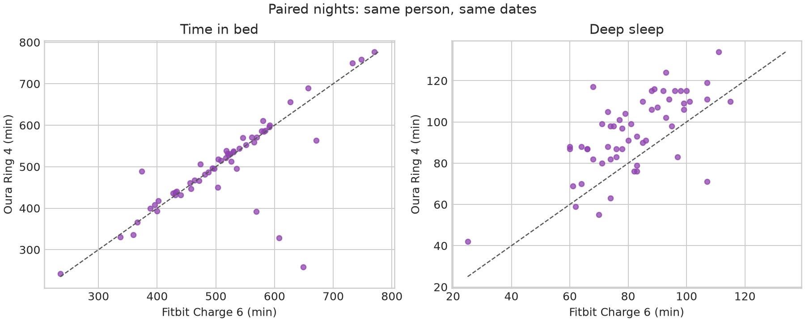
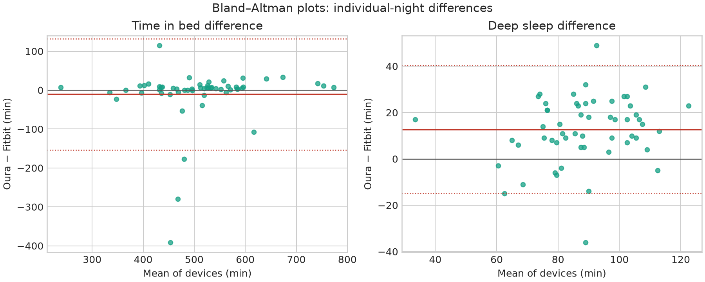
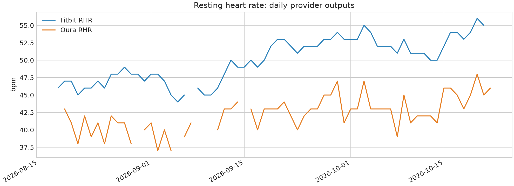

## The short version

I sold my Fitbit Charge 6, but before doing so I had enough data to compare it with the Oura Ring 4—not by impression, but by matching dates in OptiHealth.

**The main result:** the devices agree reasonably well on the overall shape of a night—when a night is longer or shorter, both usually see that. But they are not interchangeable sleep measures. In this sample, Oura recorded slightly less time in bed and total sleep, more awake time, and about 13 more minutes of deep sleep. Fitbit produced a denser raw heart-rate and activity record; Oura turned the night into a richer recovery context.

This does not mean that Oura is “right” and Fitbit is “wrong.” It means that two closed classifiers draw the boundaries between sleep, wake, movement, and recovery differently.

## Where the comparison came from

The comparison uses my OptiHealth data:

- **Fitbit:** Google Health source 35, with metadata `connectedAs=google_health_fitbit`;
- **Oura:** Oura OAuth source 72, with metadata `connectedAs=oura_ring`;
- primary comparison window: **August 18–October 22, 2026**;
- sleep was paired by the local `sleep_sessions.day`, using only `is_nap=false`;
- this produced **56 paired main-sleep nights**, from August 19 to October 21;
- daily metrics had **66 dates in common**, from August 18 to October 22.

The name “Oura Ring 4” refers to the ring used in this setup. The database identifies the Oura connection as `oura_ring`, but does not store a separate device-model field. This is therefore a comparison of one personal setup, not a laboratory test of every Charge 6 and every Ring 4.

All numbers below are descriptive. `Oura − Fitbit` is the signed difference. Spearman correlation shows whether the values move together; it does not show which device is closer to the truth. For the mean paired gap, I used a moving-block bootstrap with seven-day blocks. Intervals for individual nights are limits of agreement, not confidence intervals for the mean.

## A brief history of the two products

Fitbit Charge 6 launched in September 2023 as a wrist-first tracker: it has a display, built-in GPS, ECG, more than 40 exercise modes, and improved heart-rate tracking. Google positioned it as a device that could both track workouts and provide daily Readiness and Sleep Scores.[1]

Oura Ring 4 launched in October 2024 with a different philosophy. Its central idea is not a display or wrist-based workout tracking, but a more stable overnight and daytime sensing layer on the finger. Oura calls this platform Smart Sensing: the ring dynamically selects a sensing path based on the physiology of the individual finger; the advertised sensor stack includes multi-wavelength PPG, temperature, movement, HRV, sleep, and SpO₂.[3]

That product distinction matters. Charge 6 answers the question, “What did I do, and what was my heart rate?” Oura more often answers, “What state is my system in, and how does today fit my baseline?” Fitbit also has a readiness model, which it describes in terms of recent sleep, HRV, and resting heart rate.[2] Oura explicitly combines short-term overnight context with longer-term sleep, activity, and HRV balances.[5]

## 1. Sleep duration: there is agreement, but the night boundaries differ

| Metric | Fitbit Charge 6 | Oura Ring 4 | Oura − Fitbit | Spearman ρ |
|---|---:|---:|---:|---:|
| Time in bed | 514.5 min | 503.4 min | −11.1 min | 0.763 |
| Light + deep + REM | 470.2 min | 446.7 min | −23.5 min | — |
| Awake time | 44.1 min | 57.4 min | +13.3 min | 0.417 |
| Sleep efficiency | 91.2% | 88.5% | −2.67 pp | 0.576 |
| Sleep latency | 13.2 min | 18.0 min | +4.9 min | 0.732 |

The most useful result is not the average but the structure. Time in bed is close: the mean shift of `−11.1` minutes has a bootstrap 95% CI of **−40.8 to +9.2 minutes**, so this sample does not show a convincing constant shift. At the same time, Oura’s sum of sleep stages is about 23.5 minutes lower, while its awake time is 13.3 minutes higher.

In other words, Oura is not simply “drawing a shorter night.” It more often leaves more of the interval inside its night boundary classified as awake. Fitbit more often turns the same interval into sleep. As a result, the same night can look “reasonably efficient” in one app and noticeably fragmented in the other.

## 2. Deep sleep: Oura is consistently higher, but that does not mean it knows the truth

| Metric | Fitbit | Oura | Oura − Fitbit | 95% CI for mean | ρ |
|---|---:|---:|---:|---:|---:|
| Deep sleep | 82.0 min | 94.6 min | **+12.7 min** | **+7.6…+17.5** | 0.632 |
| Deep share of TST | 17.9% | 21.6% | **+3.73 pp** | +3.11…+4.56 | 0.724 |
| REM | 98.4 min | 100.4 min | +2.0 min | −2.8…+6.9 | 0.834 |

Oura reports more deep sleep not because it reports a longer night—in fact, the sum of its stages is lower. The difference is in the classification of sleep architecture. Deep sleep moves together only moderately between the devices (`ρ=0.632`), while REM agrees substantially better (`ρ=0.834`).

For an individual night, the mean deep-sleep gap is a poor predictor of the result: the 95% limits of agreement are approximately **−15 to +40 minutes**. The average offset is therefore stable, but an individual night can have the opposite sign. You cannot take `+12.7` and mechanically “correct” the entire Fitbit history with it.

This is exactly the situation in which a correlation in sleep duration can hide disagreement in sleep stages. In the laboratory, polysomnography uses EEG, eye movements, and muscle tone; a wearable classifier works from indirect signals such as PPG, movement, and other features. In a head-to-head study of six commercial devices against PSG, Fitbit Charge 5 showed only moderate four-stage agreement, and the authors separately emphasized high sleep sensitivity and weaker wake detection.[6] Those results cannot be transferred directly to Charge 6 or Ring 4, but they explain why “deep sleep” should not be read as a laboratory fact.

### What does the large awakening difference mean?

Across the paired nights, Fitbit reports an average of **2.6 awakenings**, while Oura reports **26.1**. The correlation is nearly absent: `ρ=0.033`.

This does not prove that I physically woke up ten times more often according to one device. These are two different vendor-defined event counters. The exported Oura timeline contains many short awake/light/REM transitions, while Fitbit compresses them into a much coarser awakening count. I therefore do not use this field as a sleep-quality ranking.

In practice, the result is useful in the opposite way: **Oura shows micro-fragmentation more strongly, while Fitbit smooths it into an easier-to-read night.** If the goal is to detect whether sleep has worsened relative to my own baseline, both can be useful. If the goal is to learn the true number of awakenings, neither field establishes it.

## 3. Heart rate: absolute levels disagree, dynamics agree

In daily `hr_resting`, Oura is about **8.2 bpm** lower than Fitbit: **42.2 versus 50.3**, with `ρ=0.799` across 58 common dates. That is a large absolute shift, but the day-to-day dynamics agree well.

The nighttime sample comparison looks different: median nighttime HR is almost identical—**46.1 for Oura versus 45.9 for Fitbit**, `ρ=0.981`, `n=45`. The difference between these results is a useful illustration of why vendor-level RHR values cannot be compared mechanically. `hr_resting` is already an aggregate with its own window, selection rules, and missingness. Median nighttime HR is a different estimand.

My practical rule after selling Fitbit is to use **within-device change** for trends, rather than trying to recalibrate Oura to Fitbit’s historical level. If Oura shows my usual level as 42, that does not make Fitbit’s level of 50 wrong; it means the two scales are not comparable in absolute units.

## 4. Activity: identical names do not guarantee identical semantics

| Daily metric | Fitbit mean | Oura mean | ρ |
|---|---:|---:|---:|
| Steps | 12,168 | 8,245 | 0.555 |
| Active calories | 776 | 523 | 0.472 |
| Total calories | 2,673 | 2,524 | 0.408 |

The correlations are positive, but not high enough to treat the values as interchangeable. Intensity minutes are especially dangerous to compare: in this data, Oura reports an average of **87.6 moderate** and **3.7 vigorous** minutes, while Fitbit reports **22.7** and **66.2**. This is not a biological paradox; it reflects incompatible thresholds and activity classifiers passing through the same Health Connect layer.

Fitbit preserves a much denser intraday HR series: **1,528,757 points over 65 days** versus **27,876 from Oura**—about **54.8 times** more points. This does not mean Fitbit is 54.8 times more accurate. It means that Charge 6 is more useful as a raw activity and workout heart-rate log, while Oura provides a sparser, more aggregated picture of state.

In this sample, Oura also adds provider-specific outputs that are not present in the Fitbit comparison: mean `Readiness 76.8`, `Sleep Score 74.5`, and `Activity Score 89.7`, along with stress, recovery, and resilience fields. Oura describes Readiness as a mixture of short-term overnight signals and longer-term 14-day balances.[5] These scales are useful as one provider’s interface, but they are not a common currency of “recovery” across brands.

## What I actually got from Oura after Fitbit

Not “more accurate deep-sleep minutes.”

I got a different observation model:

1. **Less of a screen-based device, more background context.** Oura is not trying to be a miniature watch. That reduces friction during sleep and shifts attention from individual numbers to the baseline.
2. **A denser account of fragmentation.** Oura shows awake time and short transitions more strongly; Fitbit smooths them more aggressively.
3. **A more pronounced recovery layer.** Readiness, Sleep Score, Activity Score, stress, and resilience capture not only tonight but also the history of recent days.[4][5]
4. **Worse compatibility with Fitbit history in absolute units.** Heart rate, steps, calories, and intensity minutes cannot simply be continued as one line after switching devices.
5. **Less raw data in the local export.** If I want to build my own workout-heart-rate models, the Fitbit side is substantially more convenient; if I want a morning state estimate, Oura provides more ready-made context.

## Final verdict

**Fitbit Charge 6 was the better activity measurement notebook. Oura Ring 4 is the better interface for overnight and recovery state.**

For sleep, the devices agree on which night was longer, but disagree about the boundaries and architecture. Oura systematically reports more deep sleep and awakenings, while Fitbit provides more continuous raw heart-rate data and higher step/calorie values in this particular integration. None of these shifts, by itself, establishes a physiological truth.

After switching, I would not try to merge Fitbit and Oura into one “perfect” scale. I would preserve Fitbit history as a separate source, establish Oura as a new baseline, and compare **within-device changes** going forward rather than treating the absolute values across devices as equivalent.

## Methodological limitations

- This is one person, one period, and one personal device of each type.
- The comparison begins after both sources were connected; it does not prove continuous wear on every day.
- Algorithms, firmware, apps, and export rules may have changed; versions were not frozen.
- Sleep stages and scores are proprietary outputs. There is no PSG, ECG reference, or clinical adjudication here.
- Daily `steps`, `calories`, and intensity metrics are descriptive provider outputs, not a shared physical reference standard.
- Oura SpO₂ zero values that appear in the export as missing-data sentinels were excluded as missing, rather than counted as real 0% measurements.
- The history keeps sources separate: Fitbit source 35 and Oura source 72 are not mixed with Health Connect duplicates or the Oura local source.

## Reproducibility

The paired audit was run with read-only SQL against the OptiHealth database. The figures embedded above are generated from the same reproducible analysis package; the source-specific row counts, metric-specific sample sizes, and missingness rules are retained with the working paper.

## Sources

[1] https://blog.google/products-and-platforms/devices/fitbit/fitness-tracker-charge-6
[2] https://support.google.com/fitbit/answer/14236710?hl=en-GB
[3] https://ouraring.com/blog/smart-sensing
[4] https://support.ouraring.com/hc/en-us/articles/360025445574-Sleep-Score
[5] https://support.ouraring.com/hc/en-us/articles/360025589793-Readiness-Score
[6] https://pubmed.ncbi.nlm.nih.gov/40303381
