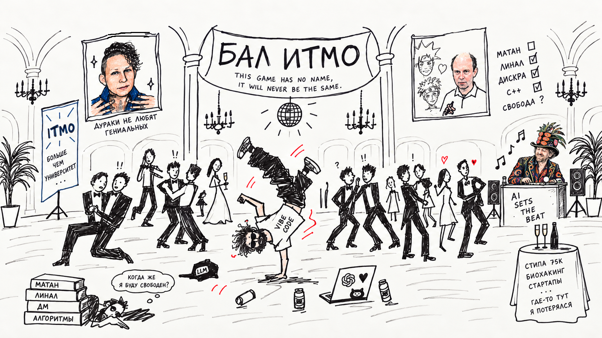

> "You fucking die," I said to him  
>I said, "You fucking die!" to him  
> Huh? What?  
> No, no, I was talkin' to the creator of AI technologies  
>I said, "You're fuckin' expelled!"  
> No, I -- we were just goofin' around  
> No, no, it didn't have anything to do with math  
> He said, "Don't tou- if anybody touches Level 3..."  
>And I said, "You fuckin' die," like that  
> Now I am finishing this shit for him?  
>You know what I mean?

And here I am on the matan committee, so I answer the tickets perfectly, so the receiver reaches the ~~pants..~~ rows...  
No luck!  
Really expelled from AI360...

I'm upset.   
I was about to close down, I had a little debt: a math exam and was missing 6 points out of 60 in C++.

But in a sense, subconsciously, I wanted to drop out.  
Just like a year ago I was preparing to retake the Unified State Exam in mathematics: I needed to score 90 points to enter the HSE PMI, but when I was preparing to retake it, I actually dreamed of ITMO.

A couple of years ago, I generally thought that a university was not needed. I thought that as a programmer I could learn everything on the Internet. This is true.   
With the advent of AI, programming has become completely devalued.

And if you want to expand the boundaries of possibilities, you need to learn mathematics! I read Stay Upwind by Paul Graham and decided to go to university...

So that you understand how much this whole idea with the “foundation” has reached an extreme:   
In the middle of the first semester, thinking about my problems with studying and the meaning of life, I came to the following philosophy:   
There are “creators” of three levels:  
1\. Craftsmen  
2\. Engineers  
3\. Architects  
So, if you want not to use what exists, but to create something radically new: learn mathematics.

An example from Yandex: when “Prigozhin went to Moscow” instead of grep by words, they limited such searches in vector space.  
Or Google: they made a search algorithm on graphs, instead of text search (pagerank)  
Or make a blockchain bridge based on oracles vs trustless bridge using Zero-Knowledge

At some point, this turned into the only argument in favor of studying  
([after all, it seems to me that life after expulsion exists](https://vk.ru/@mesyarik-pro-obuchenie-vzroslyh-s-nulya-matematike-i-programmirovaniu)).  
Moved from philosophy to religion. For the sake of the path to heaven, you need to suffer.

However, we know from the theorem on the sufficient condition for an extremum that the function reaches it only if the first nth non-zero derivative is even!  
It looks like this was an excess, not an extreme...

## I wanted 2 things from the university:

### 1. Community

I was looking for a community of people who would also be interested in doing cool things, people with a bone in their ass.  
Reality: most of my classmates are cool mathematicians and algorithmists from math schools. Some of them have never made their own projects, never written application code.  
And it seems that out of 36 people, only four are somehow interested in this.

I hoped that, well, from other universities, well, sooner or later they would get acquainted with the practice and then they would definitely be able to do something together with someone!

I wanted to enroll in Physics and Technology because graduates personally told me: you know, just when everyone is ~~fucked~~ such a mental connection is formed! For life!  
Over the course of a year, I couldn’t gather a group of people working together or even just supporting each other. Here they have several excuses:

- “LLM will explain it that way!” (but LLM won't feel where your blunt is)

- “The speed of perception of the material is different!” (I want to study with a person who already knows everything, but why would such a person study with me?)

- “What if I don’t know enough!   
What if my ego gets bruised?   
What if he already knows everything? I will continue to jerk off chatjbt...”

### 2. Foundation

I wanted more math. I got math...  
There was a lot of math, too much for me personally. Matan, linal, discra, algorithms...

I admit honestly: I wrote off most of them. Not because I'm lazy, but because I'm ~~dumb~~ doing other things. I just didn’t have time to figure it out, to understand what was happening within the framework that I set for myself.

It's not that there was no point in my studies, but:

- I copied almost all of my first semester homework on Mathan and Linal.

- KR wrote off half of the matan.

- KR on the line I’m generally silent...

I passed the Komsu matan thanks to luck.  
I honestly prepared for the supplementary and compulsory exams, every day of the holidays I sat and figured it out.

Perhaps I had the wrong preparation tactics, perhaps I am too stupid in mathematics.  
To understand: I could clearly prove 1/10 of all tickets. For the other half, I knew the wording at best.  
This time everything was much better, but the knowledge was more concentrated.

---

And here it’s worth remembering that people study in the same program at TopDS, where there are paid students - not only mathematical geniuses...

It turns out that instead of studying, I was engaged in biohacking and my own projects: in the first semester I lost the stipulation at 75k a month, and in the second I taught LLM a new modality.   
Unfortunately, no stack of intravenous Cerebrolysin and 9-methyl-beta-carboline will speed up so that you can understand the lecture not in 5, but in 2 hours, and the fourth attempt will not be assigned for the fact that you are a brilliant vibe coder...

In the second semester after college, I swore that I would study diligently: after 2 weeks of trying, I was already making a resume and dreaming of internships, a month later I was already cutting SensorLM on my younger brother’s card and completely neglected my studies, covering only what was necessary at the moment.

This strategy works if you are very good at mathematics, but, as we already understood, this is not my case...

## [When Shall I Be Free?](https://www.youtube.com/watch?v=ZcQvv8pubrc)

When... uh... a not very nice person gave me a low coefficient for the plus lab, I was very angry.   
I was angry about this whole not very good course and a thought arose:

>What if goida? What if to hell with this study?  
> Will I transfer to Group 32, get a military commission, launch a startup and move to Silicon Valley?  
> No, it’s some kind of nonsense! I'm almost closed. I'll close and decide.

Be careful with your thoughts...

## Who the fuck died?

<h4>I tried to fall in love with mathematics for 2 years. I convinced myself, I said that mathematics was cool, I studied it... I admit honestly: I don’t give a fuck about mathematics. No matter.</h4>

That’s why my channel was so meager and unsuccessful: because I wrote one thing and did another. Because the purpose of the channel was partly to make me do something I didn't want to do.   
This is not gonzo journalism. This is some kind of gonzo rape!  
I don’t think about mathematics in the background, I don’t dream about it, I don’t read about abstract mathematics without reference to practice.

I once listened to Huberman’s podcast where he talked about how to study.   
One of the takeaways was about the need to process information studied in the background and think through it.  
Math and my background thoughts: empty intersection.

One of my classmates wrote to me in a PM with the following statements:   
"Here you write code with a neuron, you roll everything around, you don’t think with your brain. But didn’t you think ~~(contradiction)~~ that all these problems with debts, being paid off on commissions are due to the fact that instead of developing your brain, you use AI as a crutch?   
I’m also stupid and spent a month of summer learning matan through blood, sweat and tears, and you?”
  
It seems that I abandoned my religion back in the summer, when I bought Claude 20x, when I vibecoded optiHealth for almost a month full time. It wasn't easy, you know!  
I also lost to my project with Sensor Language Models, probably because with the new limits I had no time left for lectures on multimodal AI.

“Here is an experienced developer who delegates to a neuron what he understands, but you don’t understand shit!”

Yes, I delegate to the neuron what I don’t fully understand.  
You can do standard tasks with your hands, or you can set yourself a task that you can only complete with a neuron.   
Singularity.

I believe that in a couple of years only the top 1% of programmers will remain - the rest will become managers, products...   
I don't think you can be top 1% in something without loving it, without being obsessed.

But I’m a bad mathematician, I’m not the creator of AI technologies, I don’t fit into your friendly community.

I tried to take on someone else's role and lost.  
I tried to stick with a couple of years of foundation on the way to level 3, but I kept running into projects.

I can't sit still. It seems that I have so many ideas, and the world is changing so quickly that sitting and coding with pens is death. A waste of time.

Although sometimes it seems that these are simply attempts at “proactive procrastination.” They say motivation will wane as soon as studying stops.   
Let's check it out, I think? Let's see who died?

## This game has no name, it will never be the same.

P.S. Despite the fact that there are a lot of “justifications” and “criticisms” here, I am grateful to ITMO for:

1. What was shoved into me is 40-60% of what was, and this is already a considerable foundation. I've really gotten better at math.

2. To the AI360 community, because I believe that it will still be possible to connect with someone.

3. Climbing sections

4. Scholarships that I spent on biohacking and sound.

5. Because they were not expelled from the university, but transferred to group 35.

6. Meshcherin for inspiration. [About expulsion](https://miptstream.ru/2016/01/16/drop-off/), [about teaching mathematics to adults](https://vk.ru/@mesyarik-pro-obuchenie-vzroslyh-s-nulya-matematike-i-programmirovaniu).  
Vitali is brilliant about sets. There are not many truly educated people these days who know why this is so interesting and unusual.
