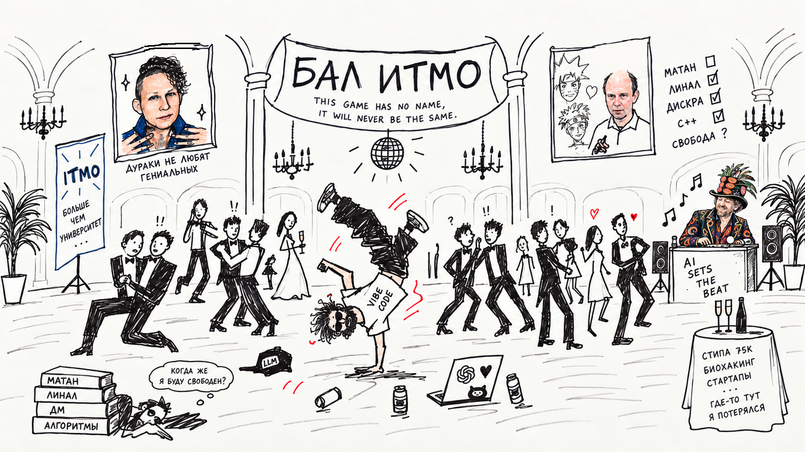

> "You fucking die," I said to him  
> I said, "You fucking die!" to him  
> Huh? What?  
> No, no, I was talkin' to the creator of AI technology  
> I said, "You’re fuckin' expelled!"  
> No, I -- we were just goofin' around  
> No, no, it didn't have anything to do with math  
> He said, "Don't tou- if anybody touches Level 3…"  
> And I said, "You fuckin' die," like that  
> Now I am finishing this shit for him?  
> You know what I mean?

So there I am in front of the panel for my final calculus retake. I’m nailing every question. Then the examiner asks me about infinite series…  
So much for my luck.  
They actually kicked me out of AI360…

I’m upset.  
I was planning to get everything signed off. All I had left was the calculus exam, and I was six points short in C++, out of a possible sixty.

But somewhere in the back of my mind, I wanted out.  
Same as a year ago, studying to retake the math part of the national entrance exam. I needed a 90 to get into Applied Math and Computer Science at HSE. All the time I was studying, the place I was actually dreaming of was ITMO.

A couple of years ago I thought I could skip university altogether. Everything I needed to learn as a programmer, I could learn online. I still think that’s true.  
Then AI came along and being able to program lost a lot of its value.

But if you want to push the limits of what you can do, you need to learn math! I’d read a little too much Paul Graham about staying upwind and decided I was going to university after all…

My obsession with getting a “foundation” reached a local extremum about halfway through my first semester. I was brooding over how much I was struggling at university and the meaning of life when I came up with a philosophy.  
There were three levels of “creator”:

1. Craftspeople
2. Engineers
3. Architects

Want to make something genuinely new instead of using what’s already there? Learn math.

Take Yandex. When “Prigozhin marched on Moscow,” they restricted those searches in vector space instead of grepping for keywords.  
Or Google. PageRank let them search a graph instead of just matching text.  
Or say you’re building a blockchain bridge. You could rely on oracles, or you could build a trustless bridge with zero-knowledge proofs.

Eventually that was the only argument I had left for staying ([I’m pretty sure there’s life after getting kicked out](https://vk.ru/@mesyarik-pro-obuchenie-vzroslyh-s-nulya-matematike-i-programmirovaniu)).  
My philosophy had turned into a religion. You want to get to heaven, you have to suffer.

But as we know from the higher-order derivative test, if the first nonzero derivative is the <i>n</i>th and the function has a local extremum there, then <i>n</i> had better be even!  
Guess that was an inflection point, not an extremum…

## I wanted two things out of university

### 1. A community

I wanted to meet people who had the same itch I did. People who couldn’t sit on their asses when there was cool shit to build.  
Turns out most of my classmates are really good at math and algorithms. They went to specialist math schools. Some had never built a project of their own or written code for an actual application.  
Out of 36 people I think maybe four even cared about that stuff.

I kept thinking, well, AI360 runs at several universities, and we’re all part of the same community. Sooner or later more of us would start building things. Surely I could find a co-founder somewhere in that crowd!

One reason I wanted to go to MIPT was what its graduates told me in person. “You’ve got to understand, when everybody’s getting ~~fucked~~ … you form this mental bond! It’s for life!”  
In a whole year I couldn’t get a study group going, or even a few people who’d look out for each other. Here are some of the excuses:

- “An LLM can explain it!” (Sure, but can it tell where you got stuck?)
- “People learn at different speeds!” (I’d love to study with somebody who already gets it. What would they get out of studying with me?)
- “What if I don’t know enough!  
  What if my ego gets bruised?  
  What if the other guy knows it all already? Guess I’ll just keep jerking ChatGPT off…”

### 2. A foundation

I wanted more math. I got math…  
A fuckton of math. Too much for me, personally. Calculus, linear algebra, discrete math, algorithms…

I’ll be honest. I copied most of it. It wasn’t laziness. I was ~~stupid~~ busy doing other things. I just couldn’t work through it all and figure out what was going on in the time I’d given myself.

I did get something out of studying, but still:

- I copied almost every first-semester calculus and linear algebra assignment.
- I copied half my calculus test.
- The linear algebra test? Let’s leave that one alone…

You get three shots at the exam. First you sit it, then you get a retake, and if you fail that too, your last shot is an oral exam in front of a panel. First semester I made it all the way to the panel and got lucky.  
I really did study for both retakes. I spent every day of the break sitting there working things out.

Maybe I went about it wrong. Maybe I’m just too dumb for math.  
That first semester, I could actually do the proofs for maybe one topic in ten. For about half the topics, the best I could do was tell you what the theorem said. Somehow I passed.  
This semester I wound up in front of the panel again. I knew half the topics cold. The other half I barely knew at all. This time my luck ran out.

---

Worth remembering that the Top DS students take the same classes. Some of them pay tuition. You don’t have to be a math genius to be here…

So I suppose it comes down to what I did instead of studying. Biohacking and my own projects. First semester I blew through a 75,000-ruble monthly stipend. Second semester I was teaching an LLM a new modality.  
Unfortunately, if it takes you five hours to get your head around a lecture, no stack of IV Cerebrolysin and 9-methyl-beta-carboline is going to get that down to two. And nobody gives you a fourth shot at an exam for being a genius vibe coder…

In my second semester, after that first panel, I swore I’d buckle down. Two weeks in I was putting together a résumé and daydreaming about internships. A month in I was building SensorLM on my little brother’s graphics card. I’d blown off classes completely. Whatever was due *right now*, I’d do. That was it.

You can get away with that if you’re really good at math. We’ve established how that worked out for me…

## [When Shall I Be Free?](https://www.youtube.com/watch?v=ZcQvv8pubrc)

When a certain… uh… less-than-wonderful person slapped a low multiplier on my C++ lab grade, I was pissed.  
Pissed at that whole less-than-wonderful course. And a thought crossed my mind:

> What if… goyda? What if I said to hell with school?  
> Switch to Group 32, get my military ID, launch a startup and move to Silicon Valley?  
> Nah, that’s ridiculous. I’ve almost passed everything. Let me get through exams and *then* I’ll decide.

Careful what you let yourself think…

## So who the fuck died?

<h4>I spent two years trying to love math. I kept telling myself math was cool. I sat down and did math… Honest to God, I don’t give a fuck about math. I just don’t care.</h4>

That’s why I barely posted on my channel and why it never went anywhere. I was writing about one thing and doing another. Part of the point of the channel was to make myself do something I didn’t want to do.  
That’s not gonzo journalism. That’s some kind of gonzo rape!  
My mind doesn’t wander to math. I don’t dream about it. I only read about abstract math when I have a use for it.

I was listening to Huberman’s podcast once and he was talking about how to study. One thing he said was that you need to turn what you’ve learned over in your head while you go about your day.  
The intersection of math and the things I think about in the background is the empty set.

One of my classmates had a bone to pick with me. He sent me this DM:  
“You get AI to write your code, you copy everything, you never think for yourself. Have you ever thought ~~(contradiction)~~ that maybe the reason you’ve got courses you still haven’t passed and you’re flunking your final retake is that you use AI as a crutch instead of learning to use your own brain?  
I’m stupid too. I spent a month of my summer on calculus. Blood, sweat and tears. What did you do?”

I think I’d already lost my religion that summer. I bought Claude 20x and spent close to a month vibe coding optiHealth full time. It wasn’t easy, I’ll have you know!  
My Sensor Language Models project took a hit too. I needed to understand the machine learning behind it, so I’d been watching lectures on multimodal AI and actually working through the material. Once I had those higher Claude limits, I spent that time vibe coding optiHealth instead. Frontend work, ordinary software engineering. The hard ML part of SensorLM? I let it slide.

“An experienced developer delegates work to AI when they understand it. You don’t understand a fucking thing!”

Yeah, I hand things to AI that I don’t fully understand.  
You can do the usual jobs by hand. You can also set yourself a job you could *only* do with AI.  
Singularity.

I believe in a couple of years only the top 1% of programmers will still be programming. The rest will be managers, product managers…  
I don’t think you get into the top 1% of anything unless you love it. Unless you’re obsessed.

Well, I suck at math. I’m no creator of AI technology. I didn’t fit into your tight-knit community.

I tried to squeeze myself into a role that wasn’t mine. And I lost.  
I tried to stick out a couple of years of foundations on my way to Level 3. I kept sneaking off to work on projects.

I can’t sit still. It feels like I’ve got so many ideas and the world’s moving so fast that sitting down and writing code by hand is death. A waste of time.

Though sometimes I wonder if this is all just “proactive procrastination.” Maybe once school’s out of the picture, there goes my motivation too.  
Shall we see if that’s all it is? See who died?

## This game has no name, it will never be the same.

P.S. For all the “excuses” and “criticism” in here, there’s plenty I’m grateful to ITMO for.

1. Somewhere between 40 and 60% of what they tried to cram into my head actually stuck. That’s a pretty solid foundation. I really did get better at math.
2. The AI360 community. I still think I’ll find someone there to connect with.
3. The climbing club.
4. The stipend I blew on biohacking and audio gear.
5. They let me stay at ITMO and transferred me to Group 35.
6. Meshcherin, for the inspiration. [On getting kicked out](https://miptstream.ru/2016/01/16/drop-off/) and [on teaching adults math](https://vk.ru/@mesyarik-pro-obuchenie-vzroslyh-s-nulya-matematike-i-programmirovaniu).  
   The bit about Vitali sets is genius. There aren’t many genuinely educated people around these days who understand why that’s so interesting and so strange.
