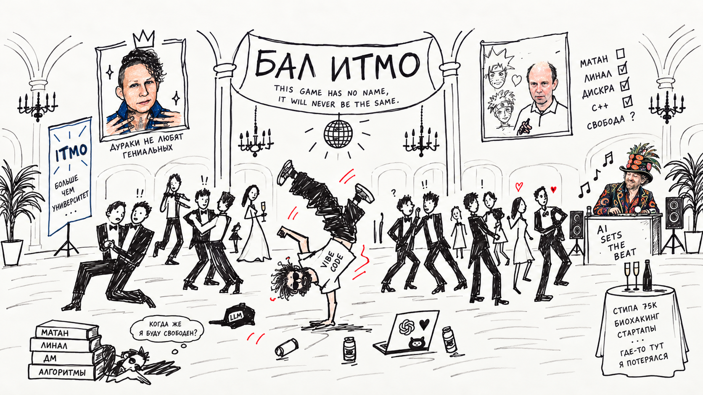

> "You fucking die," I said to him  
> I said, "You fucking die!" to him  
> Huh? What?  
> No, no, I was talkin' to создатель AI технологий  
> I said, "You’re fuckin' expelled!"  
> No, I -- we were just goofin' around  
> No, no, it didn't have anything to do with math  
> He said, "Don't tou- if anybody touches Level 3…"  
> And I said, "You fuckin' die," like that  
> Now I am finishing this shit for him?  
> You know what I mean?

И вот я на комсе по матану, вот я прекрасно отвечаю билеты, вот принимающий доходит до ~~штан..~~ рядов…  
Не фартануло!  
Реально отчислили с AI360… 

Я расстроен.   
Я собирался закрыться, у меня было немного долгов: экзамен по матану и не хватало 6 баллов из 60 по С++.

Но в каком-то смысле, подсознательно, я хотел отчислиться.  
Так же как год назад готовился к пересдаче ЕГЭ по математике: мне нужно было набрать 90 баллов, чтобы поступить на ПМИ вышки, но, когда я готовился к пересдаче, на самом деле я мечтал об ИТМО.

Пара лет назад я вообще считал, что вуз не нужен. Считал, что как программист я всему смогу научиться в интернете. Это правда.   
С появлением ИИ программирование вообще обесценилось. 

А если хочешь расширить границы возможностей, учить надо математику! Начитался stay upwind пола грэма и решил поступить в вуз…

Чтобы вы понимали, насколько эта вся идея с “фундаментом” достигла экстремума:   
В середине первого семестра, думая о своих проблемах с учебой и смысле бытия, я пришел к следующей философии:   
Есть “создатели” трех уровней:  
1\. Ремесленники  
2\. Инженеры  
3\. Архитекторы  
Так вот если хочешь не использовать существующее, а создавать кардинально новое: учи математику.

Пример из Яндекса: когда “Пригожин на Москву пошел” вместо grep по словам, они ограничили такие поиски в векторном пространстве.  
Или Google: сделали алгоритм поиска на графах, вместо поиска по тексту (pagerank)  
Или сделать блокчейн мост на оракулах vs trustless bridge, используя Zero-Knowledge

В какой-то момент это превратилось в единственный аргумент в пользу учебы  
([ведь, мне кажется, что жизнь после отчисления существует](https://vk.ru/@mesyarik-pro-obuchenie-vzroslyh-s-nulya-matematike-i-programmirovaniu)).  
Перешло из философии, в религию. Ради пути в рай — нужно страдать.

Однако мы знаем по теореме о достаточном условии экстремума, что функция достигает его только если первая n-ная ненулевая производная четная!  
Похоже это был перегиб, не экстремум…

## От вуза я хотел 2 вещи:

### 1. Сообщество

Искал комьюнити людей, которым тоже будет интересно делать крутые вещи, людей с шилом в жопе.  
Реальность: большинство моих одногруппников — это крутые математики и алгоритмисты из мат школ. Некоторые из них никогда не делали своих проектов, никогда не писали код прикладной.  
И кажется из 36 человек только четырем это как-то интересно.

Я надеялся, что ну из других вузов, ну рано или поздно они познакомятся с практикой и тогда точно с кем-нибудь вместе получится что-нибудь сделать!

Я хотел поступить на физтех, потому что выпускники мне лично рассказывали: понимаешь, просто когда всех ~~ебут~~ там такая ментальная связь образуется! На всю жизнь!  
За год я не смог собрать группу людей ботающих вместе или хотя бы просто поддерживающих друг друга. Здесь у них несколько отговорок:

- “LLM и так объяснит!” (но LLM не почувствует, где у тебя затуп)

- “Скорость восприятия материала разная!” (я хочу учиться с человеком, который уже все знает, но зачем такому человеку заниматься со мной?)

- “А что, если я недостаточно знаю!   
А что, если мое эго ущемится?   
Вдруг он уже все знает? Буду дальше дрочить чатджбт…”

### 2. Фундамент

Я хотел больше математики. Я получил математику…  
Математики было дохуя, для меня лично слишком. Матан, линал, дискра, алгоритмы…

Признаюсь честно: большинство я списал. Не потому, что я ленивый, а потому что ~~тупой~~ занимался другими вещами. Просто я не успевал разобраться, понять, что происходит в те рамки, которые я себе ставил.

Не то чтобы в моей учебе не было смысла, но: 

- почти все домашки первого семестра по матану и линалу я списал. 

- КР по матану наполовину списал.

- КР по линалу вообще молчу…

Комсу по матану я сдал благодаря удаче.  
Я честно готовился к допсе и комсе, каждый день каникул сидел и разбирался.

Возможно, у меня была неверная тактика подготовки, возможно, я слишком тупой в математике.  
Для понимания: четко доказать я мог 1\10 всех билетов. Для остальной половины я знал в лучшем случае формулировки.  
В этот раз все было сильно лучше, однако знания были более сконцентрированы.

---

И тут стоит вспомнить, что на этой же программе учатся люди на ТопДС, где есть платники — не только гении математики…

Получается дело в том, что вместо учебы я занимался биохакингом и своими проектами: в первом семе сливал стипу в 75к месяц, а во втором учил LLM новой модальности.   
К сожалению, никакой стек и внутривенного церебролизина и 9-метил-бета-карболина не разгонит так, чтобы ты мог осознать лекцию не за 5, а за 2 часа, а четвертую попытку сдачи не назначат за то, что ты гениальный вайбкодер…

Во втором семестре после комсы я поклялся, что буду прилежно учиться: через 2 недели попыток я уже делал резюме и мечтал о стажировках, через месяц я уже пилил SensorLM на карточке младшего брата и полностью забил на учебу, закрывая только то, что обязательно в моменте.

Такая стратегия прокатывает, если ты очень хорош в математике, но, как мы уже поняли, это не мой случай…

## [When Shall I Be Free?](https://www.youtube.com/watch?v=ZcQvv8pubrc)

Когда… эээ… не очень хороший человек мне поставил низкий коэффициент за лабу по плюсам, я был очень зол.   
Зол на весь этот не очень хороший курс и возникла мысль:

> А что если гойда? Что если к черту эту учебу?  
> Переведусь в 32 группу, получу военник, запущу стартап и уеду в кремниевую долину?  
> Да нет, бред какой-то! Я почти закрылся. Вот закроюсь и буду решать.

Аккуратней будьте со своими мыслями…

## Кто умер то блять?

<h4>Я пытался полюбить математику 2 года. Я внушал себе, говорил, что математика это классно, занимался ей… Признаюсь честно: мне похуй на математику. Все равно.</h4>

Мой канал поэтому так скудно и неуспешно велся: потому что я писал одно, а делал другое. Потому что цель канала была отчасти заставить меня делать то, что я не хотел.   
Это не гонзо журналистика. Это какое-то гонзо изнасилование!  
Я не думаю о математике в фоне, не мечтаю о ней, не читаю про абстрактную математику без привязки к практике.

Как-то слушал подкаст Хубермана где он рассказывал о том, как нужно учиться.   
Один из тейков был о том, что нужно обрабатывать информацию, изученную в фоне, продумывать её.  
Математика и мои фоновые мысли: пустое пересечение.

Один из одногруппников написал мне в ЛС следующие предъявы:   
“вот ты пишешь код нейронкой, все катаешь, мозгом своим не думаешь. А не думал ли ты ~~(противоречие)~~, что все эти проблемы с долгами, отлетанием на комиссии — из-за того, что ты вместо развития мозга пользуешься ИИ как костылем?   
Вот я тоже тупой и месяц лета учил матан через кровь, пот и слезы, а ты?”  
  
Кажется, что я отступился от своей религии ещё летом, когда купил Claude 20x, когда вайбкодил optiHealth почти месяц фултайм. Это было нелегко, знайте ли!  
Проиграл и своему проекту с Sensor Language Models, наверное, потому, что с новыми лимитами у меня времени на лекции по мультимодальному ИИ не осталось.

“Вот опытный разработчик нейронке делегирует то, что понимает, а ты же нихуя не понимаешь!”

Да, я делегирую нейронке то, что до конца не понимаю.  
Ты можешь делать руками стандартные задачи, а можешь поставить себе такую задачу, которую можешь выполнить только с нейронкой.   
Сингулярность.

Я верю, что через пару лет останется только топ 1% программистов — остальные станут менеджерами, продактами…   
Не думаю, что можно добиться “топ 1%” в чем-либо без любви к этому, без одержимости.

Но я плохой математик, я не создатель ИИ технологий, я не вписался в ваше дружное комьюнити.

Я пытался натянуть на себя чужую роль и проиграл.  
Я пытался выдержать пару лет фундамента, на пути к уровню 3, но постоянно сбегал в проекты.

Я не могу усидеть на месте. Кажется, что у меня столько идей, а мир меняется так быстро, что сидеть и кодить ручками это смерть. Пустая трата времени.

Хотя иногда кажется, что это просто попытки “проактивной прокрастинации”. Мол мотивация подугаснет как учеба прекратится.   
Проверим кажется ли? Посмотрим, кто умер?

## This game has no name, it will never be the same.

P.S. Несмотря на то что тут много “оправданий” и “критики”, я благодарен ИТМО за:

1. То что впихнули в меня, 40-60% от того, что было, и это уже немалый фундамент. Я правда стал лучше в математике.

2. Сообществу AI360, потому что я верю, что с кем-нибудь все-таки получится законнектится.

3. Секции скалолазания

4. Стипендии, которую я спускал на биохакинг и звук.

5. Тому что не отчислили из вуза, а перевели в 35 группу.

6. Мещерину за вдохновение. [Про отчисление](https://miptstream.ru/2016/01/16/drop-off/), [про обучение взрослых математике](https://vk.ru/@mesyarik-pro-obuchenie-vzroslyh-s-nulya-matematike-i-programmirovaniu).  
Про множества Витали гениально. Не много в наше время по настоящему образованных людей, кто знает почему это так интересно и необычно.
