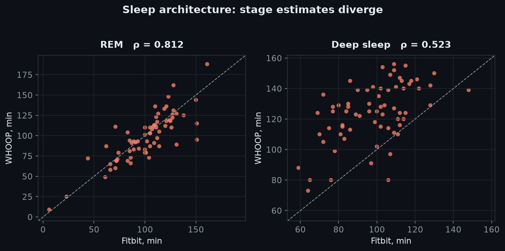
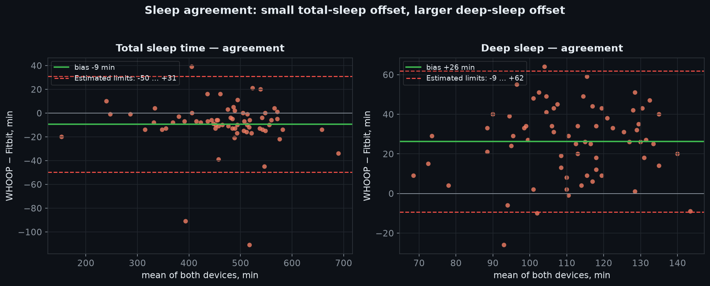
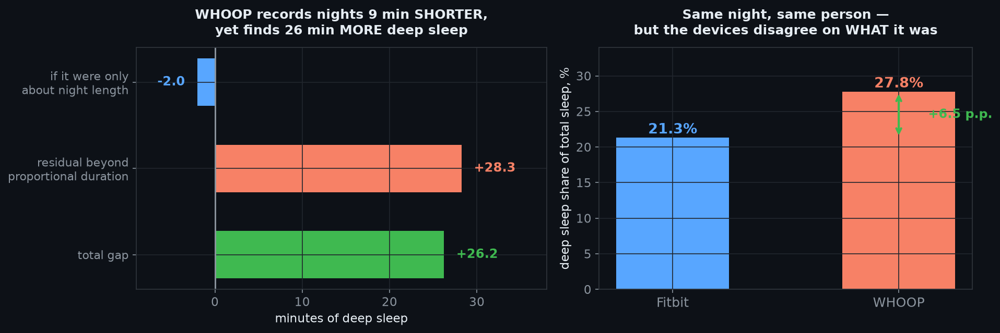
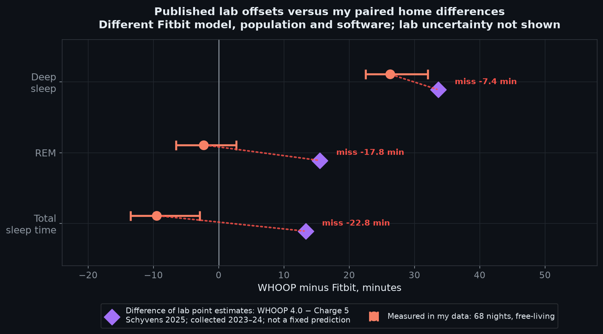
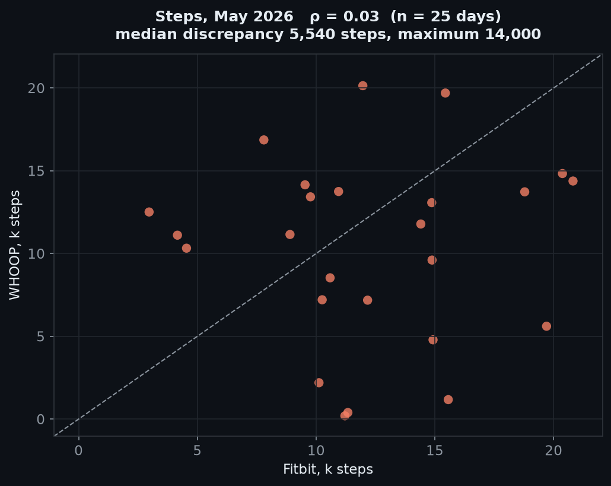

Я использовал ремешки WHOOP, Fitbit, Oura, Huawei, TicWatch и HR — множество носимых устройств! 
В прошлом году я тестировал WHOOP 4.0 вместе с Fitbit Charge 6 и носил оба **96** дней, чтобы сравнить их.

Было два периода: с 8 октября по 24 декабря 2025 года и снова в мае 2026 года.

Я не думаю, что различие WHOOP 4.0 и 5.0 здесь имеет решающее значение: улучшения Gen 5 в основном касаются HR и UX, тогда как меня больше всего интересовали сон и агрегированные данные. 
Я также предполагаю, что между Charge 6 и Fitbit Air нет существенной разницы: у них идентичные датчики и серверные алгоритмы.

## Спать

Сон — самый интересный и самый сложный для измерения показатель, и устройства существенно различаются.

Кажется, я собрал свои данные до нового алгоритма Fitbit. Единственное видимое изменение заключается в том, что время пребывания в постели сократилось, хотя я не уверен, отражает ли это изменение моего распорядка дня. ([7](___ЗАЩИТА_0___))

Стоит отметить, что пробуждения — это несколько другая метрика: в случае с Fitbit это небольшие сегменты бодрствования на гипнограмме, а WHOOP выставляет их как отдельную метрику. Корреляции тоже нет (ρ = -0,011)!

MAE в данном случае показывает разницу по всем ночам. Например, REM в целом одинаков, но MAE высок, а это означает, что отдельные ночи могут существенно различаться.

| когорта | Метрическая | п | Fitbit означает | ОУОП означает | Упс — Fitbit | МАЭ |
| --- | --- | --- | --- | --- | --- | --- |
| Р1 | Пробуждение минут | 70 | 40,3 мин | 27,8 мин | **−12,6 мин** | 15,6 мин |
| Р1 | Пробуждения | 70 | **3,36/ночь** | **11:33/ночь** | **+7,97/ночь** | 7,97/ночь |
| Р1 | Эффективность сна | 70 | 92,2% | 94,4% | **+2,25 п.п.** | 2,84 стр. |
| Р1 | Легкий сон | 70 | 274,9 мин | 239,8 мин | **−35,0 мин** | 37,5 мин |
| Р1 | Глубокий сон | 70 | 98,0 мин | 124,7 мин | **+26,7 мин** | 28,1 мин |
| Р1 | Быстрый сон | 70 | 101,4 мин | 98,4 мин | **−3,0 мин** | 12,8 мин |
| Р1 | Время в постели | 70 | 515,1 мин | 490,4 мин | **−24,7 мин** | 24,7 мин |
| май 2026 г. | Пробуждение минут | 17 | 29,4 мин | 33,4 мин | **+4,1 мин** | 4,1 мин |
| май 2026 г. | Эффективность сна | 17 | 92,4% | 92,4% | **+0,1 п.п.** | 1,4 п.п. |
| май 2026 г. | Легкий сон | 4 | 324,5 мин | 276,0 мин | **−48,5 мин** | 48,5 мин |
| май 2026 г. | Глубокий сон | 4 | 93,0 мин | 132,3 мин | **+39,3 мин** | 39,3 мин |
| май 2026 г. | Быстрый сон | 4 | 101,5 мин | 94,0 мин | **−7,5 мин** | 11,0 мин |
| май 2026 г. | Время в постели | 17 | 458,4 мин | 457,8 мин | **−0,5 мин** | 1,5 мин |

Общая продолжительность сна выглядит довольно близко:

![изображение]___ЗАЩИЩЕНО_0___

| Мера | Fitbit означает | ОУОП означает | Корреляция Спирмена |
| --- | --- | --- | --- |
| Общее время сна | 473,0 мин | 463,5 мин | **ρ = 0,961** |
| Время в постели | 513,8 мин | 491,2 мин | ρ = 0,951 |

### Постановка

Стадия сна показывает гораздо большую разницу:

| Мера | Fitbit означает | ОУОП означает | Корреляция Спирмена |
| --- | --- | --- | --- |
| Быстрый сон | 101,2 мин | 98,9 мин | ρ = 0,812 |
| **Глубокий сон** | **98,2 мин** | **124,4 мин** | **ρ = 0,523** |

Первое, что бросается в глаза, это то, что WHOOP сообщает о том, что глубокого сна на 26,3 минуты больше, но общий сон на 9 минут меньше.

Это график Бланда-Альтмана. Зеленая линия показывает среднюю разницу; красные линии показывают предел согласия в 95 %.

В то же время Fitbit сообщает о большем количестве времени в постели и о большем количестве минут бодрствования, а эффективность сна практически такая же.

Интересно, что алгоритм Fitbit сильно зависит от кислорода в крови, как и у Оры, а WHOOP измеряет его только один раз ночью (и для здоровых людей это довольно бесполезно).

### Лабораторное сравнение

Это результаты исследования 2023–2024 годов с использованием Fitbit Charge **5** ([13](https://pmc.ncbi.nlm.nih.gov/articles/PMC12038347)).

| Мера | Разница в опубликованных отклонениях, WHOOP – Fitbit Charge 5 | Моя разница между WHOOP и Fitbit Charge 6 | Моя 95%-ная блочно-загрузочная CI |
| --- | --- | --- | --- |
| Глубокий сон | +33,7 мин | **+26,3 мин** | от +22,5 до +32,0 |
| РЕМ | +15,5 мин | **−2,3 мин** | от −6,5 до +2,7 |
| Общий сон | +13,3 мин | **−9,5 мин** | от −13,5 до −2,9 |

95%-ный ДИ отражает неопределенность данных, принимая во внимание тот факт, что ночи взяты вместе.

| Мера | Предвзятость WHOOP 4.0 против ПСЖ | Предвзятость Fitbit Charge 5 против PSG |
| --- | --- | --- |
| Глубокий сон | +31,49 мин | −2,19 мин |
| РЕМ | +15,28 мин | −0,24 мин |
| Общий сон | +24.46 мин | +11,12 мин |

Опубликованные результаты в целом согласуются с моими наблюдениями во время глубокого сна, но результат быстрого сна стал сюрпризом: Fitbit был точен в исследовании, и опубликованная разница была большой, тогда как в моих данных разница между WHOOP и Fitbit невелика. Кажется, WHOOP исправил свой алгоритм обнаружения REM. ([12](___ЗАЩИТА_0___))

### Предсказывает ли глубокий сон ЧСС на следующий день?

![изображение]___ЗАЩИЩЕНО_0___

Для Фитбита да. Но означает ли это, что оценка глубокого сна Fitbit более точна, или это может быть алгоритмическая эвристика?

| Предсказатель сна | Результат на следующий день | п | Копейщик ρ | Блок-перестановка p |
| --- | --- | --- | --- | --- |
| Fitbit глубокий сон | Фитбит РРР | 67 | **−0,319** | 0,0060 |
| ОУОП глубокий сон | Фитбит РРР | 67 | +0,041 | 0,7211 |
| Fitbit глубокий сон | УОП РРР | 65 | **−0,239** | 0,0589 |
| ОУОП глубокий сон | УОП РРР | 65 | −0,050 | 0,7052 |

**Перестановка блоков** сохраняет неизменными ежедневные ряды RHR, случайным образом меняет местами значения глубокого сна в блоках, а затем снова проверяет корреляцию. После 10 000 перестановок 60 оказались как минимум такими же сильными, как оригинал (60/10 000).

Я предполагаю, что Fitbit считает ЧСС во время сна средней, а WHOOP берет самое низкое значение из последней стадии глубокого сна (как и для ВСР). Более глубокий сон означает более низкую ЧСС. Но это не совсем подходит, потому что мы используем RHR **следующего** дня.

Лично мне сон на Fitbit всегда казался хуже, чем на WHOOP. В мае исправили: теперь выглядит ещё лучше, но всё равно менее чувствителен к глубокому сну, чем WHOOP и Oura.

Стоит отметить, что WHOOP [не указывает точную стадию](https://developer.whoop.com/docs/developing/user-data/sleep/) через свой API, поэтому я не смог измерить перекрытие.

## Восстановление WHOOP и готовность Fitbit

![изображение]___ЗАЩИЩЕНО_0___

Хотя показатель восстановления WHOOP неизменно выше, на практике я считаю готовность Fitbit довольно бесполезной. WHOOP ощущается как настоящая «батарея тела», которую привыкаешь проверять каждый день, и вокруг нее строится весь UX, тогда как Readiness гораздо менее полезен.  
Часто изо дня в день он падает до одних и тех же значений.

Анализ также показывает, что он вообще не учитывает сон:

| Готовность Fitbit ([8](https://blog.google/products-and-platforms/devices/fitbit/pixel-watch-3-daily-readiness-update-cardio-target-load), [18](https://support.google.com/fitbit/answer/14236710?hl=en-GB)) и данные | п | Копейщик ρ |
| --- | --- | --- |
| ВСР RMSSD | 317 | **+0,793** |
| Отдыхающий HR | 317 | **−0,558** |
| Частота дыхания | 316 | −0,336 |
| Общая продолжительность сна | 316 | −0,015 |
| Минуты глубокого сна | 315 | +0,011 |
| быстрые минуты | 315 | +0,015 |

| Восстановление WHOOP ([17](https://support.whoop.com/s/article/WHOOP-Recovery?language=en_US)) по сравнению с данными | п | Копейщик ρ |
| --- | --- | --- |
| ВСР RMSSD | 89 | **+0,681** |
| Отдыхающий HR | 94 | **−0,453** |
| Частота дыхания | 94 | **−0,483** |
| Общая продолжительность сна | 94 | +0,352 |
| Минуты глубокого сна | 81 | +0,180 |
| быстрые минуты | 81 | +0,136 |

Эти цифры показывают, что готовность — это, по сути, среднее значение трех показателей: ЧСС, ВСР и ЧР.

| Гипотеза | п | Копейщик ρ | ЧД над БП |
| --- | --- | --- | --- |
| WHOOP – разрыв Fitbit ↔ общий сон | 61 | +0,330 | **0,0083** |
| WHOOP – разрыв Fitbit ↔ REM | 61 | +0,313 | **0,0180** |

Эта таблица подтверждает эту гипотезу. В четвертом столбце применяется перестановка блоков, как описано выше, с последующей процедурой Беньямини-Хохберга: отсортируйте p-значения, сравните каждое p-значение с (ранг / количество тестов) × 0,1 и отбросьте значения, не соответствующие порогу. Эти двое выжили, что позволяет предположить, что сон влияет на оценку WHOOP, но не на оценку Fitbit.

## Шаги

Неудивительно, что WHOOP помечает шаги как бета-функцию. Fitbit уже много лет занимается счетчиком шагов, поэтому я доверяю этому показателю гораздо больше.

## Изменились ли алгоритмы со временем?

Да, несколько раз:

- **25 февраля 2026 года** [WHOOP выпустила новый алгоритм обработки сигналов ЧСС](https://www.whoop.com/us/en/thelocker/2026-whats-new), влияющий на восстановление, напряжение и сон.

- **17 марта 2026 года** [Google объявил о повышении точности определения стадии сна на 15 %](https://blog.google/products-and-platforms/devices/fitbit/fitbit-personal-health-coach-updates-2026) для пользователей Fitbit Public Preview, а также об обновлении оценки сна. 
(Я не получил предварительную версию в своей учетной записи, поэтому это обновление, похоже, не повлияло на меня. Судя по ощущениям, глубокий сон не сильно изменился.)

## Пользовательский интерфейс устройства

Несколько слов о UX этих двух устройств:

### Фитбит

Мне понравилось, что у Fitbit есть экран. Некоторые люди говорят, что им не нужны уведомления, но уведомления не являются обязательными, и в моем случае они часто не работали должным образом. На моем Xiaomi 14 я получал сообщения на китайском языке и странные предложения изменить настройки. Это продолжалось большую часть года без исправлений, поэтому я отключил уведомления. Пиксельный опыт во всей его сути!

Время автономной работы отличное, а ОС проста и понятна.

Я также хотел от него двух вещей:

- Показать время заката, что невозможно.

- Погода. Есть специально устанавливаемое приложение, но оно бесполезно: каждый раз, когда я перехожу на страницу погоды, циферблат глючит, и мне приходится принудительно перезагружать устройство с помощью кабеля. 
За год ничего не исправили.

- ЭКГ и SpO2 привязаны к региону, поэтому, если они не одобрены в вашем регионе, вам понадобится VPN.

### УУУП

UX у WHOOP в целом лучше: здесь нет посторонних или сломанных функций. 
Приложение чистое, а показатели можно использовать.

Единственное, что мне не нравится, так это поддержка ИИ: он отправлял меня на несуществующие страницы, но оказалось, что WHOOP не поддерживает историческую синхронизацию HR. Служба поддержки пыталась убедить меня в обратном. 
Зато ответы быстрые.)

### ИИ

У обоих есть встроенные ИИ-помощники, но Fitbit снова бесполезен: он может получить доступ к вашим данным, но не интегрирован с приложением. Он не находит ничего значимого в ваших данных.

В отличие от помощника WHOOP, он также привязан к региону.

## Краткое содержание

- Fitbit имеет более открытый API и предоставляет больше данных.

- WHOOP сообщает о более глубоком сне, что кажется неправильным, но, судя по моему опыту, это кажется более точным!

– У WHOOP UX лучше, но Fitbit дешевле. 
Google обычно лишает свои продукты хороших технологий, но дает им плохой UX: он продолжает выпускать функции, о которых никто не просил, и я сомневаюсь, что разработчики сами их используют. Я надеюсь, что в будущем ситуация станет лучше.

Вот и все! Все данные анализа и сценарии можно найти на [GitHub](https://github.com/AntonIXO/whoop-vs-fitbit). 
Следующими будут Fitbit против Oura 4 (возможно, против Whoop)!
