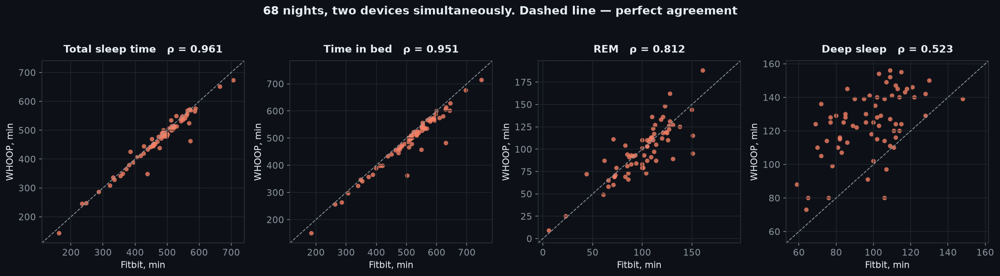
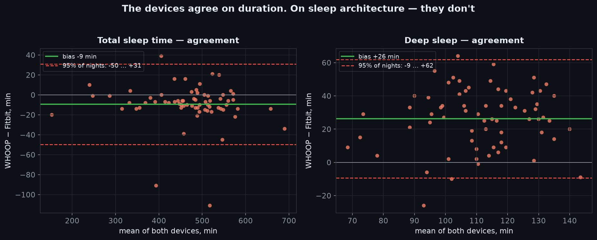
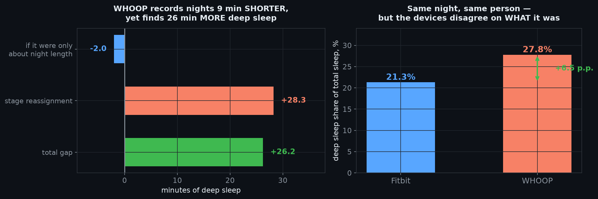
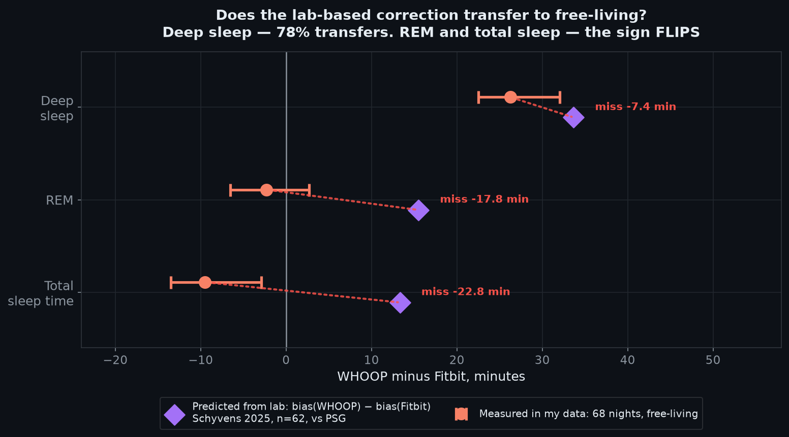
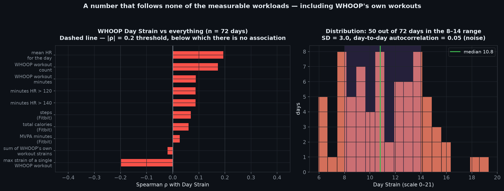
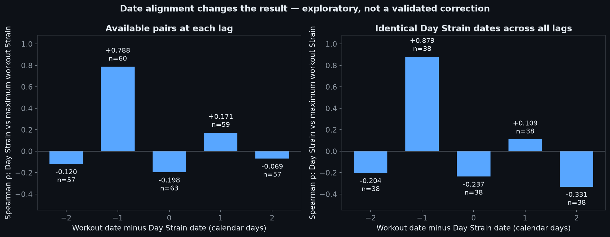
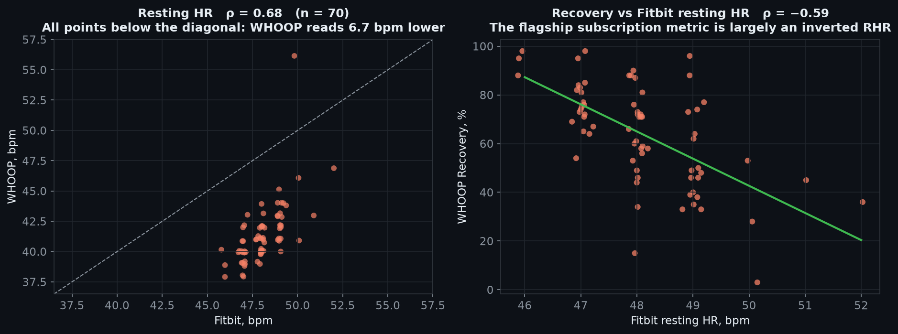
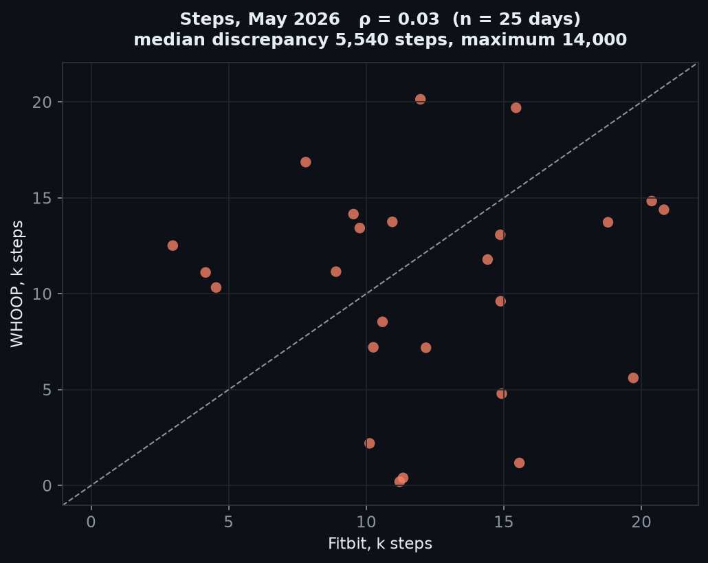
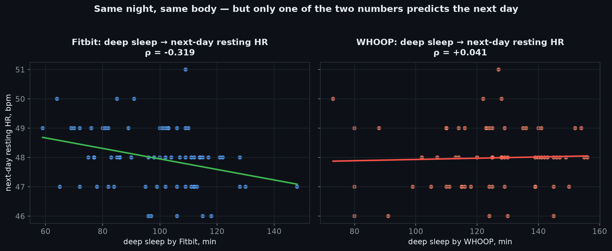

## What I found

In autumn 2025, I wore a Fitbit Charge 6 and a WHOOP 4.0 on different wrists. Both fed into my own analytics system, [OptiHealth](https://optihealth.devpins.org), so I could compare the numbers rather than my impressions.

The main sleep comparison covers **68 paired, staged nights, from 11 October to 23 December 2025**. A second window in April–May 2026 provides much less paired sleep-stage data and a separate comparison of steps.

The short version: **the devices track changes in sleep duration closely, but disagree substantially about how much of the night was deep sleep.** WHOOP Strain is a different question: it needs to be judged as an intensity–duration load, not as an expensive step counter. And the software was not necessarily the same across the two wear windows.

---

## 1. Sleep duration: close tracking is not perfect agreement

| Measure | Fitbit mean | WHOOP mean | Spearman correlation |
|---|---:|---:|---:|
| Total sleep time | 473.0 min | 463.5 min | **ρ = 0.961** |
| Time in bed | 513.8 min | 491.2 min | ρ = 0.951 |
| REM sleep | 101.2 min | 98.9 min | ρ = 0.812 |
| **Deep sleep** | **98.2 min** | **124.4 min** | **ρ = 0.523** |

When one device records a longer night, the other usually does too. WHOOP also places the start of the night about **18 minutes later**, on average.

But correlation is not accuracy. Two devices can move together and share an error; they can also correlate strongly while disagreeing by a practically important amount on individual nights. There is no polysomnography in my home data to decide which device is right.

---

## 2. Deep sleep: 26 extra minutes, despite a shorter night

WHOOP reports **26.3 more minutes of deep sleep**, on average. I had noticed the difference before doing the analysis: its deep-sleep number usually looked more generous.

The estimated Bland–Altman limits for WHOOP minus Fitbit are **−9.4 to +61.9 minutes**. That is a wide range for one sleep stage. These are descriptive limits based on the mean difference and its standard deviation, not a guarantee about future nights.

For total sleep, the limits are **−49.8 to +30.9 minutes**, around a mean difference of −9.5 minutes. So total sleep has a smaller systematic offset, but its absolute limits are not narrower than those for deep sleep. High correlation should not hide that distinction.

The obvious explanation—“WHOOP simply thinks the night was longer”—does not work:

WHOOP records **9.5 fewer minutes of sleep**. At Fitbit's mean deep-sleep share of **21.3%**, that shorter duration would predict about **2 fewer minutes** of deep sleep. Instead, WHOOP reports 26.3 more. The remaining difference under this accounting convention is **28.3 minutes**. The mean deep-sleep shares are **21.3% for Fitbit and 27.8% for WHOOP**.

This rules out a simple proportional “longer night” explanation. It is consistent with different stage classification, but it is not an epoch-by-epoch demonstration that one device relabelled exactly 28 minutes of light sleep as deep sleep. That would require aligned hypnograms.

Sleep stages are defined using physiological recordings including EEG. Wrist wearables infer them from indirect signals such as pulse and movement. Two classifiers can assign different stages to the same night.[13]

---

## 3. A laboratory bias is not a universal correction

Schyvens and colleagues compared consumer wearables against polysomnography in a study of **62 adults**. Their data were collected **from April 2023 to August 2024**, although the paper was published in 2025. Participants wore **two to four devices simultaneously**, not just one. The usable samples differed by device: **39 for Fitbit Charge 5 and 40 for WHOOP 4.0**.[13]

The paper reported a deep-sleep bias of **+31.49 minutes for WHOOP 4.0** and **−2.19 minutes for Fitbit Charge 5**. Subtracting those point estimates gives a reference gap of **+33.68 minutes**.[13]

| Measure | Difference of published biases, WHOOP−Fitbit Charge 5 | My WHOOP−Fitbit Charge 6 difference | My 95% block-bootstrap CI |
|---|---:|---:|---:|
| Deep sleep | +33.7 min | **+26.3 min** | +22.5 to +32.0 |
| REM | +15.5 min | **−2.3 min** | −6.5 to +2.7 |
| Total sleep | +13.3 min | **−9.5 min** | −13.5 to −2.9 |

The deep-sleep offset has the same direction and a broadly similar magnitude. The total-sleep point estimate has the opposite sign. REM's point estimate also reverses, but my interval includes zero.

This is **a descriptive comparison, not a formal test of a fixed laboratory prediction**. I wore a Charge 6, not the study's Charge 5. The study estimates have their own uncertainty, come from partially different device samples, and describe earlier software and a different population. My confidence intervals quantify uncertainty in my observed mean differences, not in the difference between the laboratory and home estimates.

Boundary detection is one plausible contributor: the study's validation was restricted to the PSG lights-out period, whereas home sleep detection must decide the relevant interval. The authors themselves identify algorithm updates as a limitation of longitudinal comparisons.[13] My data cannot isolate boundary detection from model version, hardware, placement, or participant differences.

The practical lesson is narrower—and more useful—than “lab validation fails”: **do not subtract a published average bias from your own wearable history and assume you have corrected it.**

---

## 4. WHOOP Strain through the lens of TRIMP

**TRIMP means duration weighted by relative cardiovascular intensity—not distance, steps, or calories.** It is a family of internal training-load measures: estimates of the body's response to work, rather than the external work itself.[1]

### What the comparison should be

A schematic Banister-style expression is

$$
h = \frac{\overline{HR}-HR_{\mathrm{rest}}}{HR_{\max}-HR_{\mathrm{rest}}},
\qquad
\mathrm{TRIMP}=T\,h\,a\,e^{bh},
$$

where $T$ is session duration in minutes, $h$ is the fraction of heart-rate reserve, and $a,b$ are coefficients of the chosen formulation. Zone-based approaches instead add time in intensity bands with different weights. These methods are not interchangeable, and session-average HR can miss the structure of intermittent exercise.[1]

WHOOP's cardiovascular Strain has the same broad intensity–duration logic, but its complete formula is proprietary and its displayed **0–21 scale is nonlinear**. It also includes non-workout load and, for supported activities, muscular load. Calling it **TRIMP-like** is defensible; calling it Banister TRIMP rescaled to 21 is not.[2][3]

A detail that matters: WHOOP's support article, published **6 October 2025** and explicitly applicable to **4.0, 5.0 and MG**, says the displayed heart-rate zones use heart-rate reserve, but **manually changing those zones does not directly change Strain**. A zone-display update is not automatically a Strain-formula update.[2]

Muscular load is not new to 2026. WHOOP launched Strength Trainer for **WHOOP 4.0 on 25 April 2023**, incorporating muscular load into Strain. The 2026 changes expanded automatic estimation to more activity types.[11][5]

### What my export shows

The existing analysis compares Day Strain with daily activity summaries, excluding **11–12 October 2025**, the two dates omitted by the original figure. That leaves **72 scored days**; each correlation uses only dates with both measurements. The full export spans **8 October–24 December 2025** and retains 8–9 October even after these exclusions. They are therefore not the first two exported days, and their calibration status is unverified. The audit reports both inclusion and exclusion cohorts.

| Comparison with Day Strain | Spearman ρ | Paired dates |
|---|---:|---:|
| Fitbit total calories | +0.061 | 72 |
| Fitbit steps | +0.070 | 72 |
| Fitbit MVPA minutes | +0.027 | 72 |
| Recorded minutes with HR >120 bpm | +0.088 | 71 |
| Recorded minutes with HR >140 bpm | +0.087 | 71 |
| WHOOP workout minutes | +0.088 | 69 |
| Mean recorded daily HR | +0.194 | 71 |
| Sum of WHOOP workout Strains | −0.020 | 63 |
| Maximum WHOOP workout Strain | −0.198 | 63 |

These are weak descriptive associations. They do **not**, by themselves, establish that Strain is useless:

- **Steps and calories are not the target construct.** A long easy walk and a shorter hard effort need not have the same ranking under an intensity-weighted load.[1][3]
- **An absolute HR threshold is not personalised intensity.** Minutes above 120 bpm do not reconstruct a full HR-reserve distribution. A daily mean, maximum, and a few threshold counts do not preserve the trajectory needed to reconstruct nonlinear load.
- **Session Strains are not additive.** WHOOP explicitly says that two workouts scoring 10 do not make a Day Strain of 20.[3] Even so, nonlinearity is not a universal excuse: applying a strictly increasing transformation to one scalar preserves its Spearman ranks. Log compression alone cannot erase a correctly aligned monotonic load relationship.
- **Dates must refer to the same interval.** WHOOP's developer API attaches Strain to physiological cycles, which need not align with calendar days.[4] Its current consumer explainer describes a midnight reset.[3] Those descriptions do not establish how my historical export was dated. I need the actual cycle boundaries and workout timestamps, not a guessed one-day shift.
- **Missing workout data are not automatically rest days.** Nor does low lag-one autocorrelation prove that a score is white noise.

### The date alignment changes the result

I checked actual calendar offsets from −2 to +2 days, without filling missing dates or treating adjacent rows as adjacent days. Pairing **Day Strain on date d with workouts on date d−1** changes the picture:

| Comparator | Same exported date | Previous calendar day |
|---|---:|---:|
| Maximum workout Strain | ρ = −0.198, n = 63 | **ρ = +0.788, n = 60** |
| Sum of workout Strains | ρ = −0.020, n = 63 | **ρ = +0.672, n = 60** |
| Workout minutes | ρ = +0.088, n = 69 | **ρ = +0.554, n = 65** |

This is not just a change in which dates survive. Restricting the maximum-workout comparison to the **same 38 Day Strain dates with data at every tested offset**, the correlations are **−0.237 at zero lag and +0.879 at −1 day**.

Another consistency flag follows the same pattern: Day Strain falls below the largest workout Strain on **17 of 63 same-date pairs**, versus **3 of 60 previous-day pairs**. That is a flag conditional on complete, correctly aligned intervals—not proof of a broken scoring algorithm.

**The original “WHOOP disagrees with itself” conclusion does not survive this alignment check.** A dating or cycle-boundary mismatch is a serious candidate explanation. The lag was explored after seeing the discrepancy, however, so I do not silently shift the data, report a selected-lag significance test, or claim to have established the correct join. Cycle boundaries, timestamps, and score completeness remain necessary to resolve it.

The audit also computes a deliberately simple exploratory proxy, $M_{100}+M_{120}+M_{140}$, where $M_x$ is recorded minutes above $x$ bpm. This weights the disjoint upper-HR bands increasingly and gives **ρ = +0.014 on 71 same-date pairs**. It is **not TRIMP**: its thresholds and weights are not personalised, it omits lower-HR exposure, and the original extraction query for the wide HR table is absent. The proxy cannot settle the validity question either.

**Can I calculate actual TRIMP from the article's current data? Not reliably.** The local Strain table contains daily HR summaries and absolute-threshold counts, not a timestamped HR series with coverage and historical maximum/resting-HR settings. It cannot reconstruct Banister or Edwards TRIMP, or WHOOP's proprietary transformation. I do not replace those missing inputs with invented heart rates or label a custom threshold proxy “TRIMP”.

The proper next comparison would calculate a specified HR-based load over the **same intervals** as completed WHOOP scores, separate cardiovascular-only from muscular-load activities, and retain sensor coverage. Using WHOOP's own HR would test internal consistency; using a reference chest strap would provide a more independent check. My present result is **poor correspondence with the available daily summaries**, not a completed validation or refutation of TRIMP-like Strain.

---

## 5. Recovery overlaps with resting heart rate

Resting heart rate correlates across devices at about **ρ = 0.68**, but WHOOP reports values **6.7 bpm lower on average**. The difference is systematic in this sample; it is not evidence that one device measured my physiological resting rate correctly.

WHOOP Recovery correlates with Fitbit resting heart rate at **ρ = −0.59 across 70 paired days**. That is useful overlap with a simpler measurement.

It does **not** prove that Recovery is merely inverted resting HR or contributes no additional information. Establishing that would require testing incremental predictive value beyond RHR against an independent outcome—not just correlating two daily summaries.

---

## 6. Steps: the exported records disagree

From **1 to 28 May 2026**, the Health Connect exports contain **25 paired days**. The step-count correlation is **ρ = 0.03**. The median absolute difference is **5,540 steps**, with discrepancies of roughly 14,000 on some days.

There are very low WHOOP totals on dates when Fitbit reports an active day. That is a serious disagreement in the records I actually receive.

It is not yet a clean test of the step-detection algorithms themselves. Wearing time, sync completeness, source selection, and day boundaries can all affect exported daily totals. I found no verified, dated step-algorithm release that establishes the cause of this May mismatch. I would not merge these two exported step series as though they were interchangeable.

---

## 7. An exploratory lead: deep sleep and next-day RHR

Without PSG, another question is whether a device's deep-sleep estimate is associated with a later physiological measurement.

- Fitbit deep sleep versus next-day Fitbit RHR: **ρ = −0.319**.
- WHOOP deep sleep versus the same next-day Fitbit RHR: **ρ = +0.041**.

The negative Fitbit association is an interesting lead, not proof of superior staging. The outcome is itself Fitbit-derived, so this is not an independent reference instrument. Shared sensor and processing effects, persistence in RHR, sleep duration, and other time-varying factors remain possible explanations.

**None of the 32 hypotheses in the original exploratory family passed its multiple-testing correction.** I treat this as a question for another wear window, not a validated prediction or evidence that one device's deep sleep is biologically “real” and the other's is not.

---

## 8. Did the algorithms change between October and May?

**There were relevant product and algorithm releases. Whether every one reached my account or WHOOP 4.0 is not recorded in this dataset.** That distinction matters: an announcement date is not a personal model-version log.

| Date or documented bound | Verified change | Relevance to my windows |
|---|---|---|
| **11 September 2024** | Google described a redesigned Fitbit Daily Readiness algorithm incorporating RHR alongside HRV and sleep.[8] | Predates both windows. It should not be misdated as an October 2025 release merely because a support page was updated then. |
| **By 2 May 2025** | A WHOOP staff reply described a sleep-staging update trained with more CQU/Arizona lab data and new signal interpretation.[12] | An update was already documented before my October start. The December recap is not evidence that this same update launched in December. |
| **By 6 October 2025** | WHOOP documented personalised HR-reserve zones for 4.0/5.0/MG, with Strain calculated independently of manual zone boundaries.[2] | Already documented before the first paired night. Personal calibration may evolve without a new algorithm release. |
| **2025, recapped 15 December** | WHOOP described an updated Sleep Performance score using sufficiency, consistency, efficiency, and stress, and its sleep-staging improvements.[6] | Confirms product evolution, but the recap alone does not date account-level rollout. Sleep Performance is not the same variable as minutes in a sleep stage. |
| **January 2026** | WHOOP lowered the minimum workout auto-detection duration from 15 to 10 minutes. On 8 January it expanded passive muscular-load estimation to rucking and Solidcore.[5] | Between windows; activity counts and supported Activity Strain can change without equivalent changes in behaviour. |
| **10–18 February 2026** | WHOOP shipped automatic muscular-load estimation for weightlifting, functional fitness, HIIT, and additional activity types.[5] | Between windows; relevant if those activity types were used. This expanded an existing muscular-load component rather than inventing it. |
| **25 February 2026** | WHOOP's release log records a new HR signal-processing algorithm, explicitly affecting the data behind Recovery, Strain, and Sleep.[5] | A genuine between-window measurement change. The entry does not establish my exact rollout date or explicitly resolve eligibility for my 4.0. |
| **17 March 2026** | Google announced an additional **15% increase in sleep-staging accuracy for Public Preview users**, with tracking rolling out over the following days and a redesigned Sleep Score to follow.[7] | Potentially relevant to April–May sleep. The percentage is Google's validation claim, not a measured improvement in me and not necessarily 15 percentage points. My Preview participation is unverified. |
| **22 April 2026** | WHOOP expanded automatic muscular-load estimation to 14 outdoor/adventure and labour activities, including rowing, climbing, skiing, and shovelling.[5] | On the first date in my second paired-sleep window; applies to the listed activities, not all daily movement. |
| **20 May 2026** | WHOOP updated workout auto-detection and classification, including strength work and lower-Strain sustained activity.[5] | Near the end of the second window; workout counts and labels need not be directly comparable with autumn. |
| **6 July 2026** | WHOOP's release log records another HR algorithm update.[5] | **After both windows. It cannot explain the October–May difference.** |

The important implication for the sleep comparison is that **the 2023–2024 validation study, my autumn 2025 measurements, and my spring 2026 measurements are not demonstrably the same measurement system**. Software version belongs alongside hardware model, wrist placement, and data source in the methods section.

This does not prove an algorithm update caused any observed change. With only **six paired staged nights** in April–May, no saved per-night model versions, and no reference PSG, the project cannot separate software changes from changes in my sleep or recording coverage. The second window's roughly **+37-minute WHOOP deep-sleep offset** is a small descriptive follow-up, not a clean replication under a fixed instrument.

---

## What I take away

1. **Sleep duration moves together across the devices**, but neither agreement nor high correlation establishes accuracy against PSG.
2. **Absolute deep-sleep minutes are not interchangeable.** WHOOP averages 26.3 minutes higher in my main window. Trends within one device still need attention to software changes.
3. **Strain deserves a TRIMP-like test, not a step-count test.** Its weak associations with my available summaries remain interesting, but the present export does not validate the internal-load calculation or establish that it is useless.
4. **Recovery overlaps with RHR.** Whether it adds useful information is a separate, unanswered question.
5. **Do not splice these step exports into one history** without checking completeness and attribution.
6. **Changing software can change the instrument even when I keep the same wristband.** A change in the chart is not automatically a change in my health.

## How this was analysed

The measurements are the project's existing CSV extracts from OptiHealth. This revision uses those local files; it does not re-extract or change the live database.

- **Spearman correlation** describes rank associations, with pairwise complete observations.
- The original exploratory analyses use **serial-dependence-aware block permutation tests**; the descriptive Strain table is not presented as a set of confirmed discoveries.
- Mean paired sleep-gap intervals use **20,000 moving-block bootstrap resamples**, with the settings in `analysis/phase4_literature_test.py`.
- **Bland–Altman** plots show systematic offsets and the spread of paired differences.
- Deep sleep is examined in both minutes and as a share of total sleep.
- Algorithm-release claims are sourced separately from personal measurements. Source pages describe releases and mechanisms, not proof of which version produced an individual historical row.

See [GLOSSARY.md](GLOSSARY.md) for definitions and [README.md](README.md) for reproduction instructions and unresolved data requirements.

**Limitations:** one person; no simultaneous home PSG; different wrists without a crossover; device and software mismatch with the laboratory reference; unequal coverage across metrics; unresolved cycle/calendar alignment for Strain; possible incomplete Health Connect exports; no saved historical algorithm versions or Fitbit Preview status. Oura has only five nights in the existing project and is not included.

## Sources

[1] https://www.mdpi.com/2227-7080/11/3/79
[2] https://support.whoop.com/s/article/What-is-Max-Heart-Rate-and-How-Do-I-Adjust-It
[3] https://www.whoop.com/us/en/thelocker/how-does-whoop-strain-work-101
[4] https://developer.whoop.com/docs/developing/user-data/cycle
[5] https://www.whoop.com/us/en/thelocker/2026-whats-new
[6] https://www.whoop.com/us/en/thelocker/everything-whoop-launched-in-2025
[7] https://blog.google/products-and-platforms/devices/fitbit/fitbit-personal-health-coach-updates-2026
[8] https://blog.google/products-and-platforms/devices/fitbit/pixel-watch-3-daily-readiness-update-cardio-target-load
[11] https://www.whoop.com/us/en/press-center/whoop-introduces-strength-trainer-becomes-first-wearable-to-measure-muscular
[12] https://www.community.whoop.com/t/whats-new-in-whoops-sleep-staging-algorithm-update/321
[13] https://pmc.ncbi.nlm.nih.gov/articles/PMC12038347