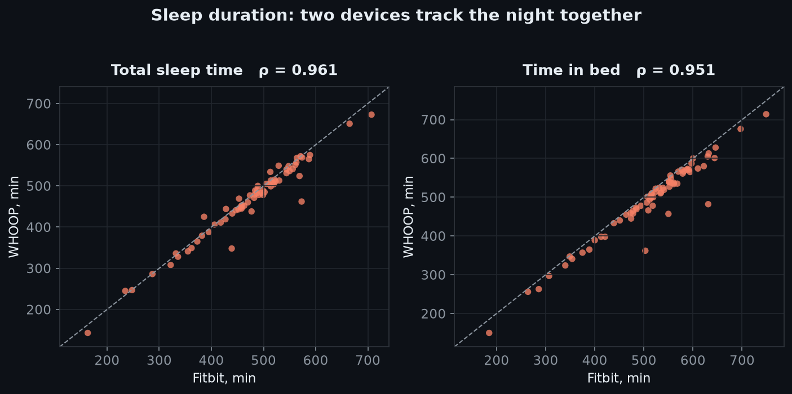
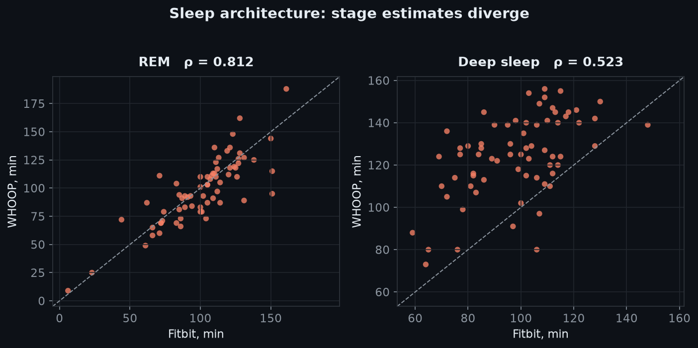
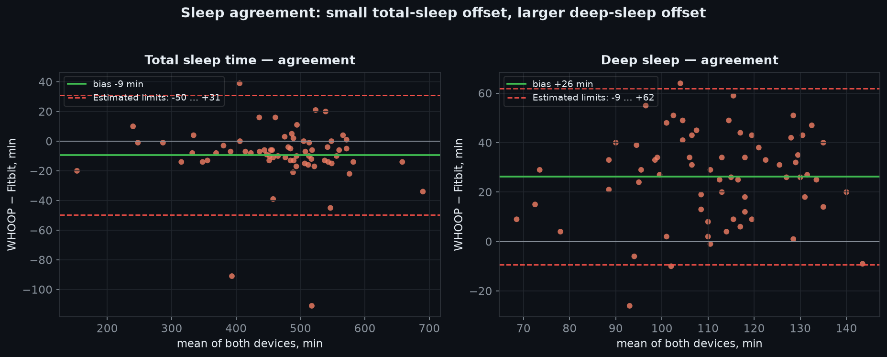
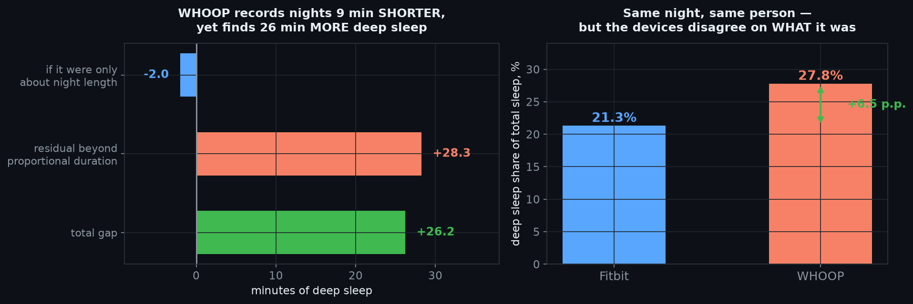
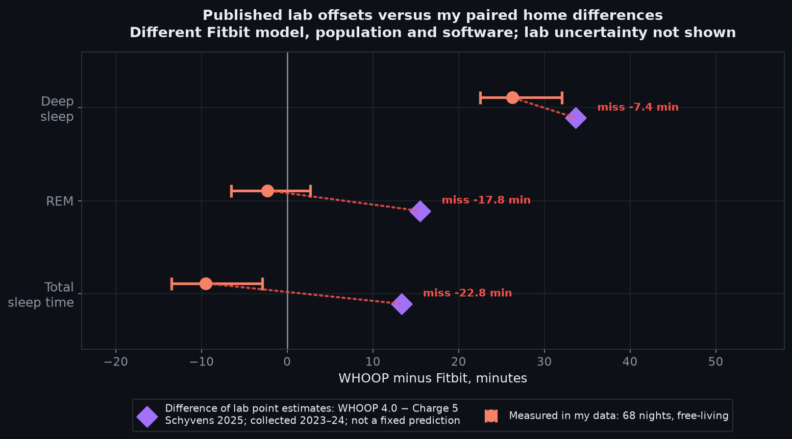
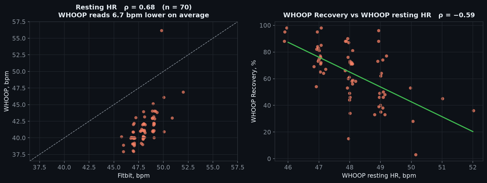
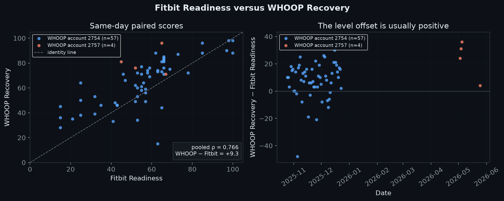
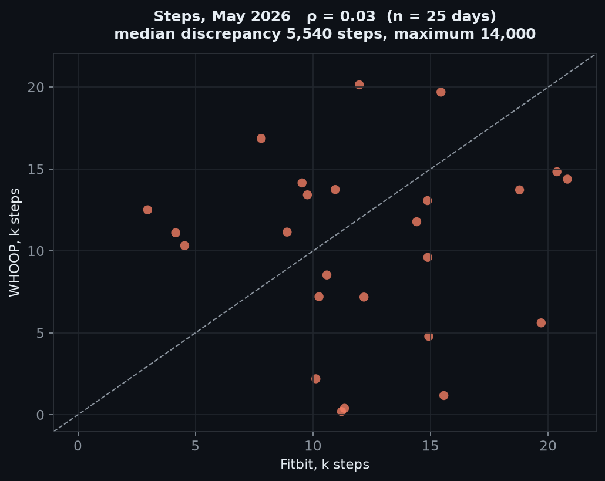

I’ve used WHOOP, Fitbit, Oura, Huawei, TicWatch and HR straps—plenty of wearables! 
Over the past year, I tested a WHOOP 4.0 alongside a Fitbit Charge 6 and wore both for **96** days to compare them.

There were two periods: from 8 October to 24 December 2025, and again in May 2026.

I don’t think the WHOOP 4.0 versus 5.0 distinction is critical here: Gen 5’s improvements are mainly around HR and UX, while I was mostly interested in sleep and aggregate data. 
I also assume that there is no relevant difference between the Charge 6 and Fitbit Air: they have identical sensors and server-side algorithms.

## Sleep

Sleep is the most interesting and hardest-to-measure metric, and the devices differ substantially.

It seems that I collected my data before Fitbit’s new algorithm. The only visible change is that time in bed was reduced, although I am not sure whether this reflects a change in my routine. ([7](https://blog.google/products-and-platforms/devices/fitbit/fitbit-personal-health-coach-updates-2026))

It is worth noting that awakenings are a somewhat different metric: in Fitbit’s case, they are small awake segments on the hypnogram, while WHOOP exposes them as a separate metric. There is no correlation either (ρ = -0.011)!

MAE, in this case, shows the difference across all nights. For example, REM is generally similar, but the MAE is high, which means that individual nights can still differ substantially.

| Cohort | Metric | n | Fitbit mean | WHOOP mean | WHOOP − Fitbit | MAE |
| --- | --- | --- | --- | --- | --- | --- |
| P1 | Awake minutes | 70 | 40.3 min | 27.8 min | **−12.6 min** | 15.6 min |
| P1 | Awakenings | 70 | **3.36/night** | **11.33/night** | **+7.97/night** | 7.97/night |
| P1 | Sleep efficiency | 70 | 92.2% | 94.4% | **+2.25 pp** | 2.84 pp |
| P1 | Light sleep | 70 | 274.9 min | 239.8 min | **−35.0 min** | 37.5 min |
| P1 | Deep sleep | 70 | 98.0 min | 124.7 min | **+26.7 min** | 28.1 min |
| P1 | REM sleep | 70 | 101.4 min | 98.4 min | **−3.0 min** | 12.8 min |
| P1 | Time in bed | 70 | 515.1 min | 490.4 min | **−24.7 min** | 24.7 min |
| May 2026 | Awake minutes | 17 | 29.4 min | 33.4 min | **+4.1 min** | 4.1 min |
| May 2026 | Sleep efficiency | 17 | 92.4% | 92.4% | **+0.1 pp** | 1.4 pp |
| May 2026 | Light sleep | 4 | 324.5 min | 276.0 min | **−48.5 min** | 48.5 min |
| May 2026 | Deep sleep | 4 | 93.0 min | 132.3 min | **+39.3 min** | 39.3 min |
| May 2026 | REM sleep | 4 | 101.5 min | 94.0 min | **−7.5 min** | 11.0 min |
| May 2026 | Time in bed | 17 | 458.4 min | 457.8 min | **−0.5 min** | 1.5 min |

Overall sleep duration looks pretty close:

| Measure | Fitbit mean | WHOOP mean | Spearman correlation |
| --- | --- | --- | --- |
| Total sleep time | 473.0 min | 463.5 min | **ρ = 0.961** |
| Time in bed | 513.8 min | 491.2 min | ρ = 0.951 |

### Staging

Sleep staging shows a much larger difference:

| Measure | Fitbit mean | WHOOP mean | Spearman correlation |
| --- | --- | --- | --- |
| REM sleep | 101.2 min | 98.9 min | ρ = 0.812 |
| **Deep sleep** | **98.2 min** | **124.4 min** | **ρ = 0.523** |

The first thing that catches the eye is that WHOOP reports 26.3 more minutes of deep sleep, but 9 minutes less total sleep.

At the same time, Fitbit reports more time in bed and more awake minutes, while sleep efficiency is nearly the same.

It is interesting that the Fitbit algorithm depends heavily on blood oxygen, like Oura’s, while WHOOP measures it only once at night (and it is pretty useless for healthy people).

### Lab comparison

These are results from a 2023–2024 study using Fitbit Charge **5** ([13](https://pmc.ncbi.nlm.nih.gov/articles/PMC12038347)).

| Measure | Difference of published biases, WHOOP−Fitbit Charge 5 | My WHOOP−Fitbit Charge 6 difference | My 95% block-bootstrap CI |
| --- | --- | --- | --- |
| Deep sleep | +33.7 min | **+26.3 min** | +22.5 to +32.0 |
| REM | +15.5 min | **−2.3 min** | −6.5 to +2.7 |
| Total sleep | +13.3 min | **−9.5 min** | −13.5 to −2.9 |

The 95% CI captures uncertainty in the data while accounting for the fact that the nights are taken together.

| Measure | WHOOP 4.0 bias vs PSG | Fitbit Charge 5 bias vs PSG |
| --- | --- | --- |
| Deep sleep | +31.49 min | −2.19 min |
| REM | +15.28 min | −0.24 min |
| Total sleep | +24.46 min | +11.12 min |

The published results generally agree with my deep-sleep observations, but the REM result is a surprise: Fitbit was accurate in the research, and the published difference was large, while the difference between WHOOP and Fitbit is small in my data. It seems that WHOOP fixed its REM-detection algorithm. ([12](https://www.community.whoop.com/t/whats-new-in-whoops-sleep-staging-algorithm-update/321))

### Does deep sleep predict next-day RHR?

For Fitbit, yes. But does that mean Fitbit’s deep-sleep estimate is more accurate, or could it be an algorithmic heuristic?

| Sleep predictor | Next-day outcome | n | Spearman ρ | Block-permutation p |
| --- | --- | --- | --- | --- |
| Fitbit deep sleep | Fitbit RHR | 67 | **−0.319** | 0.0060 |
| WHOOP deep sleep | Fitbit RHR | 67 | +0.041 | 0.7211 |
| Fitbit deep sleep | WHOOP RHR | 65 | **−0.239** | 0.0589 |
| WHOOP deep sleep | WHOOP RHR | 65 | −0.050 | 0.7052 |

**Block permutation** keeps the daily RHR series intact, randomly swaps deep-sleep values in blocks, and then checks the correlation again. After 10,000 permutations, 60 were at least as strong as the original (60/10,000).

My guess is that Fitbit counts RHR as medium during sleep, while WHOOP takes the lowest value from the latest deep-sleep stage (as it does for HRV). More deep sleep means a lower HR. But this does not fit perfectly, because we are using the **next**-day RHR.

Personally, sleep always looked worse to me on Fitbit than on WHOOP. In May, they fixed it: it now looks even better, but it is still less sensitive to deep sleep than WHOOP and Oura.

It is worth noting that WHOOP [does not provide exact stage](https://developer.whoop.com/docs/developing/user-data/sleep/) breakdowns through its API, so I could not measure the overlap.

## WHOOP Recovery vs Fitbit Readiness

Although WHOOP Recovery is consistently higher, I find Fitbit Readiness pretty useless in practice. WHOOP feels like a real “body battery” that you get used to checking every day, and the whole UX is built around it, while Readiness is much less useful.  
It often collapses to the same values from day to day.

The analysis also suggests that it does not take sleep into account at all:

| Fitbit Readiness ([8](https://blog.google/products-and-platforms/devices/fitbit/pixel-watch-3-daily-readiness-update-cardio-target-load), [18](https://support.google.com/fitbit/answer/14236710?hl=en-GB)) vs data | n | Spearman ρ |
| --- | --- | --- |
| HRV RMSSD | 317 | **+0.793** |
| Resting HR | 317 | **−0.558** |
| Respiratory rate | 316 | −0.336 |
| Total sleep duration | 316 | −0.015 |
| Deep sleep minutes | 315 | +0.011 |
| REM minutes | 315 | +0.015 |

| WHOOP Recovery ([17](https://support.whoop.com/s/article/WHOOP-Recovery?language=en_US)) vs data | n | Spearman ρ |
| --- | --- | --- |
| HRV RMSSD | 89 | **+0.681** |
| Resting HR | 94 | **−0.453** |
| Respiratory rate | 94 | **−0.483** |
| Total sleep duration | 94 | +0.352 |
| Deep sleep minutes | 81 | +0.180 |
| REM minutes | 81 | +0.136 |

These numbers suggest that Readiness is essentially an average of three metrics: HR, HRV and RR.

| Hypothesis | n | Spearman ρ | BH over BP |
| --- | --- | --- | --- |
| WHOOP−Fitbit gap ↔ total sleep | 61 | +0.330 | **0.0083** |
| WHOOP−Fitbit gap ↔ REM | 61 | +0.313 | **0.0180** |

This table supports the hypothesis. The fourth column applies block permutation, as described above, followed by the Benjamini–Hochberg procedure: sort the p-values, compare each p-value with (rank / number of tests) × 0.1, and discard the values that fail the threshold. These two survived, suggesting that sleep contributes to the WHOOP score but not to the Fitbit score.

## Steps

## Did the algorithms change over time?

Yes, several times:

- On **25 February 2026**, [WHOOP released a new HR signal-processing algorithm](https://www.whoop.com/us/en/thelocker/2026-whats-new) affecting Recovery, Strain and Sleep.

- On **17 March 2026**, [Google announced a 15% sleep-staging accuracy improvement](https://blog.google/products-and-platforms/devices/fitbit/fitbit-personal-health-coach-updates-2026) for Fitbit Public Preview users, with a redesigned Sleep Score to follow. 
(I did not get the preview on my account, so this update does not seem to have affected me. Based on how it feels, deep sleep has not changed much.)

## Device UX

A few words about the UX of these two devices:

### Fitbit

I liked that Fitbit has a screen. Some people say they do not want notifications, but notifications are optional - and in my case they often did not work properly. On my Xiaomi 14, I received messages in Chinese and strange prompts to change settings. This continued for much of the year without fix, so I turned notifications off. Pixel experience in all its essence!

The battery life is excellent, and the OS is simple and clean.

I also wanted two things from it:

- Show sunset time, which is not possible.

- Weather. There is a custom installable app, but it is unusable: every time I swipe to the weather page, the watch face glitches, and I have to force-reboot the device using a cable. 
There has been no fix in a year.

- ECG and SpO2 are region-locked, so if they are not approved in your region, you need a VPN.

### WHOOP

WHOOP’s UX is generally better: there are no extraneous or broken features. 
The app is clean, and the metrics are usable.

The only thing I don’t like is the AI support: it sent me to pages that did not exist, but it turned out that WHOOP does not support historical HR syncing. Support tried to convince me otherwise. 
The replies are fast, though.)

### AI

Both have built-in AI assistants, but Fitbit’s is useless again: it can access your data, but it is not integrated with the app. It does not find anything meaningful in your data.

## Summary

- Fitbit has a more open API and provides more data.

- WHOOP reports more deep sleep, which seems wrong, but it feels more precise based on my experience!

- WHOOP’s UX is better, but Fitbit is cheaper. 
Google generally starves its products of good technology but gives them bad UX: it keeps releasing features nobody asked for, and I doubt developers use them themselves. I hope this gets better in the future.

That’s it! All analysis data and scripts can be found on [GitHub](https://github.com/AntonIXO/whoop-vs-fitbit). 
Fitbit vs Oura 4 (maybe vs Whoop) is next!
